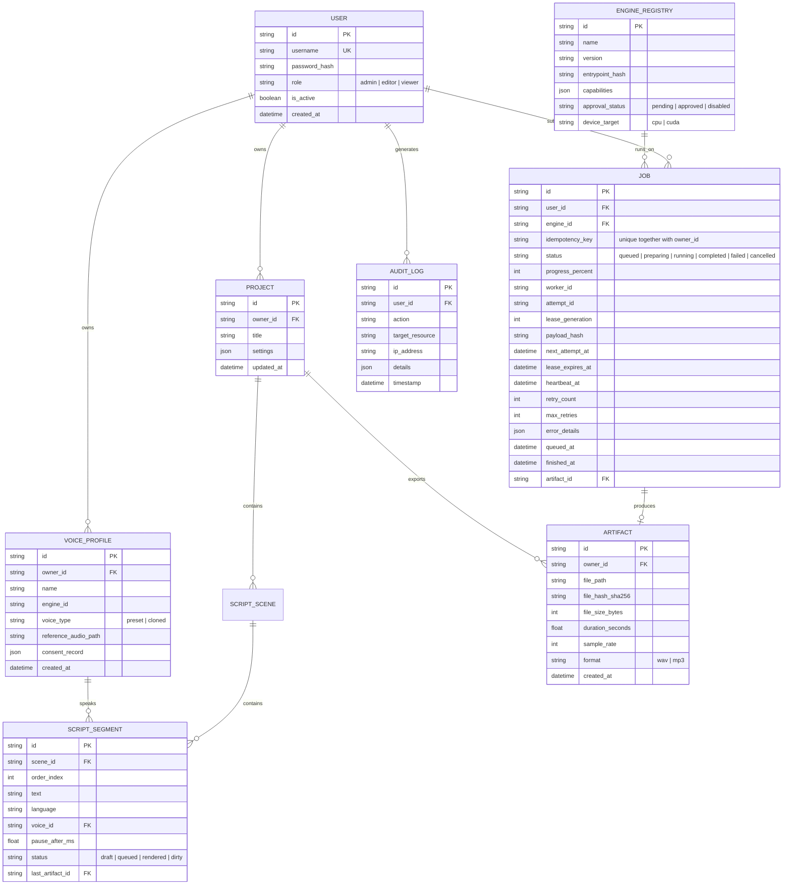

# API SPECIFICATION & DATA ARCHITECTURE DESIGN (REVISION R1)
**Project:** AI Voice Studio — Professional Modular AI Platform  
**Document ID:** ARCH-API-001-R1  
**Status:** R1.1 — PROPOSED / PENDING OWNER APPROVAL (documentation revision only)  
**Date:** October 2026  

> **Canonical contract:** [CANONICAL_CONTRACTS.md](CANONICAL_CONTRACTS.md). This R1.1 text is a design proposal, not evidence of implementation or measured performance. For contradictions, canonical contracts and accepted ADRs take precedence.

---

## 1. REST API Design Principles (Revision R1)

1. **Strict Versioning:** Endpoints are rooted at `/api/v1/`. Breaking changes mandate a major version increment.
2. **Asynchronous Non-Blocking Semantics:** Long-running AI operations respond immediately with `202 Accepted` returning a `job_id`, polling location, and SSE event stream URI.
3. **RFC 9457 Standardized Errors:** All client errors (4xx) and server errors (5xx) return the `application/problem+json` media type complying with **RFC 9457**.
4. **Resilient SSE Streaming with Reconnects:** Server-Sent Events include monotonic event IDs (`id: <seq>`). Reliable `Last-Event-ID` resume requires persisted `job_events`; if replay is unavailable or expired, the client must re-query `GET /api/v1/jobs/{id}`. SSE is supplemental, not the source of truth.

---

## 2. Core API Endpoints Catalog

### 2.1 Identity, Onboarding & Security
* `GET /api/v1/auth/status` — Returns system bootstrap state (`needs_onboarding: true/false`).
* `POST /api/v1/auth/onboard` — Atomic, one-time Administrator bootstrap requiring an out-of-band local setup secret. Never publicly exposed in LAN setup mode.
* `POST /api/v1/auth/login` — Authenticates user with username/password, returns JWT token.
* `POST /api/v1/auth/refresh` — Refreshes expired session token.
* `GET /api/v1/auth/me` — Returns current authenticated user and permissions.

### 2.2 Engines & Models Management
* `GET /api/v1/engines` — List registered engines and their declared capabilities.
* `GET /api/v1/engines/{id}` — Detailed engine metadata and parameter schema.
* `POST /api/v1/engines/{id}/approve` — Admin authorization to enable discovered engine.
* `POST /api/v1/engines/{id}/unload` — Request worker to unload model weights from memory.

### 2.3 Projects & Dialogue Workspace
* `GET /api/v1/projects` — List projects owned by or shared with current user.
* `POST /api/v1/projects` — Create new project workspace.
* `GET /api/v1/projects/{id}` — Retrieve full project script, scenes, and segment statuses.
* `PUT /api/v1/projects/{id}` — Autosave script edits and character assignments.
* `POST /api/v1/projects/{id}/render` — Enqueue batch generation for all pending lines.
* `POST /api/v1/projects/{id}/export` — Master concatenate all segments into normalized WAV/MP3.

### 2.4 Voice Profiles & Consent Library
* `GET /api/v1/voices` — List available voices (preset voices + user-owned cloned profiles).
* `POST /api/v1/voices` — Upload reference audio, sign consent audit, create cloned voice profile.
* `GET /api/v1/voices/{id}` — Retrieve voice metadata and waveform preview URL.
* `DELETE /api/v1/voices/{id}` — Delete cloned voice profile and remove associated audio sample.

### 2.5 Inference Job Queue
* `POST /api/v1/jobs/speech` — Submit TTS job (Requires authenticated user, validated engine parameters, request-payload hash, user-scoped idempotency key).
* `POST /api/v1/jobs/clone` — Submit voice cloning job (Requires reference sample + text).
* `GET /api/v1/jobs/{id}` — Query current job state, lease info, execution logs.
* `POST /api/v1/jobs/{id}/cancel` — Abort a pending or running job.
* `GET /api/v1/jobs/{id}/events` — SSE stream for real-time progress and status updates.

### 2.6 Audio Artifacts & Streaming
* `GET /api/v1/artifacts/{id}` — Stream or download generated audio (`audio/wav` or `audio/mpeg`).
* `GET /api/v1/artifacts/{id}/waveform` — Returns pre-computed 100-point JSON waveform array for UI rendering.

---

## 3. Relational Database Schema (SQLite 3 WAL)



---

## 4. Atomic Job Leasing & Lifecycle Query Design

To prevent race conditions without external message brokers, workers claim jobs using SQLite's **immediate transaction isolation**:

```sql
-- CANONICAL INITIAL CLAIM: only QUEUED jobs may be claimed here.
-- :now, :lease_expiry and :attempt_id are generated by the scheduler.
-- Transaction must run on the actual SQLite runtime and be integration-tested.
BEGIN IMMEDIATE;
UPDATE jobs
SET status = 'preparing',
    worker_id = :worker_id,
    attempt_id = :attempt_id,
    lease_generation = lease_generation + 1,
    lease_expires_at = :lease_expiry,
    heartbeat_at = :now
WHERE id = (
    SELECT id FROM jobs
    WHERE status = 'queued'
      AND (next_attempt_at IS NULL OR next_attempt_at <= :now)
    ORDER BY queued_at, id
    LIMIT 1
)
AND status = 'queued'
RETURNING id, engine_id, user_id, attempt_id, lease_generation;
COMMIT;
```

**Separate recovery path (mandatory):** An expired `PREPARING/RUNNING` lease does **not** directly enter the claim query. The supervisor first validates ownership and process termination, then atomically transitions the attempt to `FAILED`/`QUEUED` according to retry policy with backoff. Each attempt has a new `attempt_id`/`lease_generation`. Heartbeat, cancel and completion writes must match that generation (fencing). A stale worker cannot mark a job completed or publish an artifact.

**Delivery semantics:** The scheduler may retry work; infer *at-least-once processing attempts*, not exactly-once synthesis. Enforce `(owner_id, idempotency_key)` uniqueness plus an identical payload hash. Idempotency key reuse with a different payload must return a conflict. Media publication uses staging + checksum + atomic same-volume rename and transactional registry update; cross-filesystem/DB atomicity is impossible, so implement reconciliation and cleanup for orphaned files/records.

**Events:** Persist a `job_events` table (`job_id`, `sequence`, `event_type`, `payload`, `created_at`) if supporting `Last-Event-ID` replay. Do not use in-memory SSE to claim durable event delivery.

### Zombie Reclaim & Expiry Logic
* The active worker must renew its lease with the correct worker ID, attempt ID and fencing generation. Heartbeat interval and expiry must be configured and empirically tested; 5s / 15s are initial examples, not unconditional guarantees.
* If a worker crashes, the supervisor must reconcile/terminate the stale process and reclaim via the separate recovery transaction; it may retry or fail based on the configured policy. Never allow a second concurrent attempt merely because a timestamp expired.

---

## 5. Storage Hierarchy & Windows Permissions

All persistent storage paths are configurable via environment variable `STUDIO_DATA_DIR` (configurable; `D:\AIVoiceStudioData` is an owner-proposed optional location, not hardcoded):

```
D:\AIVoiceStudioData\
├── studio.db                      # Primary SQLite database
├── studio.db-wal                  # WAL write cache
├── backups/                       # Automated online database snapshots
│   └── studio_backup_20261008.db
├── models/                        # Pretrained model weights (Persists across app updates)
│   ├── vieneu/                    # ONNX checkpoints
│   └── qwen3-0.6b/                # PyTorch safetensors
├── voices/                        # Uploaded reference voice samples (UUID filenames)
│   └── 9b1deb4d-3b7d-4bad-9bdd-2b0d7b3dcb6d.wav
└── artifacts/                     # Generated audio files
    ├── temp/                      # Intermediate segment scratch files (GC after 7 days)
    │   └── scratch_job_123.tmp
    └── exports/                   # Master final exported tracks
        └── prj_48a7f_master.wav
```

### Windows Security & File Access Controls
* Filesystem permissions must be verified with a non-destructive ACL audit and applied for the effective service account only with explicit user permission. Do not copy a blanket `icacls` command into installation scripts.
* Every file upload is assigned a non-enumerable UUIDv4; path traversal (`../`) is blocked by verifying that `Path(target).resolve().is_relative_to(STUDIO_DATA_DIR)`.
