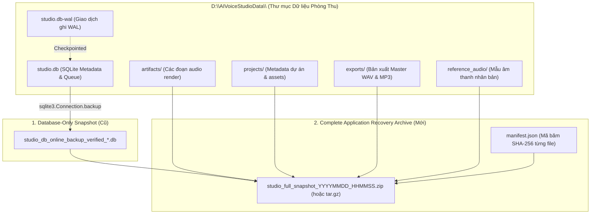

# AI VOICE STUDIO — THIẾT KẾ HỆ THỐNG SAO LƯU TOÀN DIỆN VÀ PHỤC HỒI THẢM HỌA
## COMPREHENSIVE BACKUP & DISASTER RECOVERY ARCHITECTURE DESIGN (POST-PHASE 5B)

- **Trạng thái**: Kiến trúc đề xuất cho vận hành đa người dùng (Proposed)
- **Tác giả**: Principal Security Architect, Data Reliability Auditor
- **Phạm vi bảo vệ**: Cơ sở dữ liệu SQLite và toàn bộ kho tệp tin âm thanh nhị phân (Filesystem Audio Assets).

---

## 1. BỐI CẢNH VÀ VẤN ĐỀ CỦA PHƯƠNG PHÁP CŨ

Trong các giai đoạn trước (Phase 0 đến Phase 4), việc sao lưu chủ yếu tập trung vào cơ sở dữ liệu `studio.db`. Tuy nhiên, trong kiến trúc phòng thu âm thanh chuyên nghiệp:
1. Cơ sở dữ liệu chỉ chứa metadata, phân đoạn kịch bản, và đường dẫn tới các tệp âm thanh nhị phân.
2. Dữ liệu thực sự mang giá trị nội dung lớn nhất là các tệp âm thanh WAV/MP3 nằm trên hệ thống tệp (`D:\AIVoiceStudioData\`).
3. **Nếu chỉ phục hồi cơ sở dữ liệu mà không phục hồi hệ thống tệp:** Dẫn đến trạng thái "bản ghi ma" (Dangling Artifacts) — metadata trỏ đến các tệp không còn tồn tại trên ổ cứng.
4. **Nếu chỉ phục hồi hệ thống tệp mà không phục hồi cơ sở dữ liệu:** Các tệp âm thanh bị mồ côi (Orphaned Files), người dùng không thể quản lý hoặc liên kết lại kịch bản.

Do đó, bắt buộc phải có một **Thiết kế sao lưu ứng dụng toàn diện (Complete Application Recovery Architecture)**.

---

## 2. PHÂN ĐỊNH RÕ RÀNG: DATABASE-ONLY vs COMPLETE APPLICATION RECOVERY



| Tiêu chí so sánh | 1. Database-Only Recovery (Cũ) | 2. Complete Application Recovery (Đề xuất mới) |
| :--- | :--- | :--- |
| **Phạm vi bảo vệ** | Chỉ tệp SQLite `studio.db` | Cả `studio.db` và 4 thư mục: `artifacts`, `projects`, `exports`, `reference_audio` |
| **Thời gian sao lưu** | Rất nhanh (< 1 giây) | 2 đến 10 giây tùy dung lượng audio |
| **Tính đồng nhất** | Nhất quán cấp độ giao dịch bảng | Nhất quán toàn diện (Atomic Snapshot) qua Manifest SHA-256 |
| **Kịch bản áp dụng** | Kiểm toán schema, migration rollback | Phục hồi thảm họa phần cứng, di chuyển máy chủ, mã hóa tống tiền (Ransomware) |

---

## 3. THIẾT KẾ CẤU TRÚC GÓI SAO LƯU TOÀN DIỆN (FULL BACKUP MANIFEST ARCHITECTURE)

Mỗi lần tạo một bản sao lưu toàn diện, hệ thống sẽ sinh ra một gói lưu trữ tiêu chuẩn tại `D:\AIVoiceStudioData\backups\complete\`:

### 3.1. Cấu trúc thư mục gói sao lưu
```text
studio_full_backup_20261009_163000/
├── manifest.json                                # Bảng kê toàn vẹn mật mã
├── database/
│   └── studio_db_online_backup_verified.db      # Snapshot SQLite đã checkpoint
└── storage/
    ├── artifacts/                               # Toàn bộ bản thu phân đoạn
    │   ├── rendered_seg_0.wav
    │   └── ...
    ├── exports/                                 # Toàn bộ bản xuất Master DSP
    │   ├── master_export_1.wav
    │   └── master_export_2.mp3
    ├── reference_audio/                         # Toàn bộ giọng đọc mẫu cloning
    └── projects/                                # Dữ liệu dự án đính kèm
```

### 3.2. Cấu trúc tệp Bảng kê Toàn vẹn (`manifest.json`)
```json
{
  "version": "1.0",
  "created_at": "2026-10-09T09:30:00Z",
  "architecture_version": "R1.1",
  "alembic_revision": "20261009_0006",
  "database": {
    "filename": "studio_db_online_backup_verified.db",
    "size_bytes": 421888,
    "sha256": "cac11bc5c4c849a9fdee4b2d8d9ad94f04a1f34378bdddc91e54b4b20c3a0818",
    "table_counts": {
      "users": 14,
      "projects": 9,
      "script_segments": 32,
      "artifacts": 36,
      "jobs": 38,
      "login_attempts": 48
    }
  },
  "filesystem_assets": {
    "artifacts_count": 36,
    "exports_count": 8,
    "reference_audio_count": 0,
    "total_storage_bytes": 15420380,
    "files": [
      {
        "relative_path": "artifacts/art_01.wav",
        "size_bytes": 115244,
        "sha256": "8a3f..."
      }
    ]
  }
}
```

---

## 4. QUY TRÌNH TỰ ĐỘNG HÓA VÀ DIỄN TẬP PHỤC HỒI (DISASTER RECOVERY DRILL)

1. **Nguyên tắc "Đọc Kiểm Trước Khi Ghi" (Verify-Before-Commit):**
   Mọi thao tác khôi phục từ gói sao lưu đều phải giải nén vào một thư mục tạm `C:\Users\...\AppData\Local\Temp\dr_drill_sandbox\`.
2. **Kiểm tra Đối soát 2 chiều (Bi-Directional Audit):**
   - Mỗi file trong thư mục `storage/artifacts/` phải có bản ghi tương ứng trong bảng `artifacts` và khớp chính xác mã SHA-256.
   - Mỗi bản ghi `active_artifact_id` trong bảng `script_segments` phải trỏ đến một file âm thanh tồn tại trên đĩa.
3. **Không ghi đè dữ liệu còn giá trị:**
   Nếu thư mục `D:\AIVoiceStudioData\` vẫn còn dữ liệu hiện hành, hệ thống sẽ tự động đổi tên thành `D:\AIVoiceStudioData_pre_recovery_<timestamp>` trước khi đưa dữ liệu sao lưu vào hoạt động.
