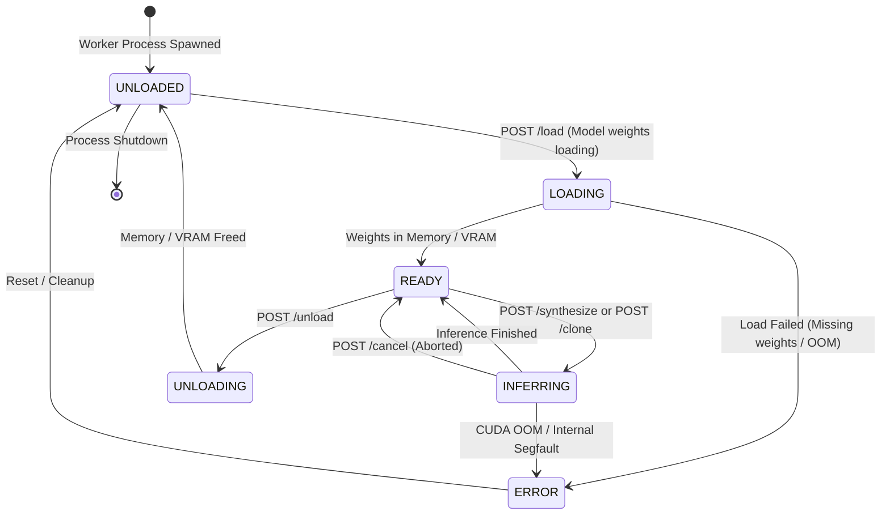

# ENGINE ADAPTER SDK & PLUGIN CONTRACT SPECIFICATION (REVISION R1)
**Project:** AI Voice Studio — Professional Modular AI Platform  
**Document ID:** ARCH-PLG-001-R1  
**Status:** R1.1 — PROPOSED / PENDING OWNER APPROVAL (documentation revision only)  
**Date:** October 2026  

> **Canonical contract:** [CANONICAL_CONTRACTS.md](CANONICAL_CONTRACTS.md). This R1.1 text is a design proposal, not evidence of implementation or measured performance. For contradictions, canonical contracts and accepted ADRs take precedence.

---

## 1. Engine SDK Design Principles (Revision R1)

1. **Zero Hardcoded Engine Logic:** Core business logic has no dependency on specific engine names. It interacts solely through the **Engine Adapter SDK Contract v1.0**.
2. **Capability-Driven Contracts:** No universal assumptions about features (e.g. pitch, speed, or voice cloning). An engine declares only what it supports.
3. **Security & Trusted Plugin Policy:** Running an external Python script can execute arbitrary code. The platform strictly enforces that **only Admin-approved adapters pinned to a reviewed source/package (with verified integrity metadata)** may be registered and executed. Untrusted third-party code execution is strictly prohibited.
4. **Distinct Metadata Separation:** Complete decoupling of:
   * **Engine Metadata:** Adapter code, author, license, SDK version.
   * **Model Metadata:** Checkpoint weights, file hashes, download sources, VRAM requirements.
   * **Voice Metadata:** Preset speakers, custom cloned speaker profiles, consent records.
   * **Runtime Configuration:** Environment path, execution device (CPU/CUDA), port, timeouts.

---

## 2. Standardized Plugin Manifest (`engine.manifest.json` v1.0)

Every engine directory must provide an `engine.manifest.json` validated against JSON Schema. **The following is a non-installable illustration**: model capabilities, runtime versions, sizes and hashes MUST be verified before approval (placeholder values are intentionally invalid for production):

```json
{
  "$schema": "https://ai-voice-studio.local/schemas/engine.manifest.v1.json",
  "manifest_version": "1.0",
  "engine_id": "vieneu-tts",
  "name": "VieNeu-TTS v3 Turbo",
  "version": "0.1.0-proposed",
  "author": "pnnbao97 (Adapted for AI Voice Studio)",
  "license": "Apache-2.0",
  "integrity": {
    "entrypoint_sha256": "<populate-from-reviewed-installed-artifact>"
  },
  "capabilities": [
    "text_to_speech",
    "voice_cloning",
    "speaker_selection"
  ],
  "supported_languages": ["vi"],
  "default_sample_rate": 48000,
  "runtime": {
    "entrypoint": "engines/vieneu/worker.py",
    "python_version_min": "3.10",
    "python_version_max": "3.12",
    "virtualenv_path": "engines/vieneu/.venv"
  },
  "hardware_profile": {
    "supported_devices": ["cpu", "cuda"],
    "default_device": "cpu",
    "estimated_vram_mb": 0,
    "estimated_ram_mb": 1500
  },
  "parameters_schema": {}
}
```

---

## 3. Worker Lifecycle & State Machine

A worker process transitions through distinct operational states tracked by the supervisor:



---

## 4. Worker HTTP Protocol & Standardized Error Contracts

Workers expose an authenticated HTTP service on loopback (`127.0.0.1:<ephemeral_port>`). Every request must include the header `X-Worker-Token: <secret>`.

### 4.1 Protocol Endpoints

| Endpoint | Method | Input | Output | Purpose |
| :--- | :--- | :--- | :--- | :--- |
| `/health` | GET | None | `{ status, state, device, memory_mb }` | Liveness & state probe. |
| `/info` | GET | None | Manifest metadata & preset voices. | Capability discovery. |
| `/load` | POST | `{ model_id, device }` | `{ status, loaded_at }` | Explicitly load model weights. |
| `/synthesize` | POST | JSON (text, voice_id, params) | `audio/wav` binary payload | Synthesize speech. |
| `/clone` | POST | Multipart (text, audio file) | `audio/wav` binary payload | Clone voice from sample. |
| `/cancel` | POST | `{ job_id }` | `{ status: "cancelled" }` | Abort ongoing generation. |
| `/unload` | POST | None | `{ status: "unloaded", freed_mb }` | Free VRAM/RAM immediately. |

### 4.2 Standardized Error Contract (RFC 9457 Format)

When an error occurs, the worker responds with standard HTTP status codes and a structured JSON body adhering to **RFC 9457**:

```json
{
  "type": "https://ai-voice-studio.local/errors/cuda-out-of-memory",
  "title": "CUDA Out of Memory",
  "status": 507,
  "detail": "Failed to allocate 1.2 GiB on GPU 0. Free memory was only 450 MiB.",
  "instance": "/jobs/job_948a7f21",
  "code": "CUDA_OOM",
  "retryable": true,
  "backoff_seconds": 5
}
```

#### Standard Error Codes:
* `MODEL_NOT_FOUND` (404): Checkpoint files missing on disk.
* `INVALID_INPUT_PARAMS` (400): Text exceeds length limit or parameters violate schema.
* `UNSUPPORTED_LANGUAGE` (422): Engine does not support the requested language token.
* `CUDA_OOM` (507): GPU VRAM exhausted during synthesis.
* `INFERENCE_TIMEOUT` (504): Synthesis exceeded max execution limit.
* `WORKER_INTERNAL_ERROR` (500): Unhandled Python exception.

---

## 5. Security & Trusted Plugin Verification Policy

To prevent arbitrary code execution on the host machine:
1. **Administrative Authorization Gate:** Newly discovered directories in `engines/` are marked `PENDING_APPROVAL` in `studio.db`. The core server will not launch a worker until an Admin explicitly approves it via `/api/v1/engines/{id}/approve`.
2. **Integrity and provenance:** Pin upstream commit/release, full dependency lock and model weights. Compare SHA-256 against trusted reviewed artifacts; hashing an arbitrary local file without a trusted expected digest establishes **no** source authenticity. Track approver, fingerprint, changes and revocation.
3. **Least privilege:** Worker launch explicitly binds to loopback and is network-restricted where feasible. `.venv` and loopback bindings are **not security sandboxes**; workers inherit OS permissions unless separately restricted. Unknown third-party engine code is not automatically safe to execute.

---

## 6. Contract Verification Suite (`tests/contract/`)

The plugin contract is verified via an automated Pytest test harness before any engine is integrated into production:

```python
# Conceptual contract test ensuring engine compliance
def test_engine_contract_compliance(authenticated_worker_client):
    # 1. Verify health & state
    health = authenticated_worker_client.get("/health").json()
    assert health["status"] == "healthy"
    assert health["state"] in ["UNLOADED", "READY"]

    # 2. Verify RFC 9457 error on invalid language
    err = authenticated_worker_client.post("/synthesize", json={
        "job_id": "test_err_01",
        "text": "Hello",
        "language": "invalid_lang_code"
    })
    assert err.status_code == 422
    assert err.json()["code"] == "UNSUPPORTED_LANGUAGE"

    # 3. Verify synthesis output
    res = authenticated_worker_client.post("/synthesize", json={
        "job_id": "test_ok_01",
        "text": "Test speech synthesis.",
        "language": "en"
    })
    assert res.status_code == 200
    assert res.headers["Content-Type"] == "audio/wav"
```


## 7. Contract evolution and worker cancellation (R1.1 clarification)

- Required: `health`, `info`, `synthesize` if `text_to_speech` is declared. Conditional: `clone`, `cancel`, `stream`, `load`, `unload`; unsupported capability must return a typed not-supported error.
- Manifest declares `sdk_contract_version`, `engine_version`, `model_version` separately. Validate both engine and parameter JSON Schema in the core; do not expose arbitrary file-system paths to clients.
- Cancellation is best effort; supervisor escalates to process-tree termination after grace period. Worker must never mark a stale attempt completed: every request and callback carries `job_id`, `attempt_id`, `lease_generation`.
- Worker `X-Worker-Token` mitigates accidental/unauthorized loopback calls but does not defend against malicious processes running under the same Windows user.
- Verify contract via mock worker, invalid-capability tests, malformed audio tests and third-engine plug-in scenario.
