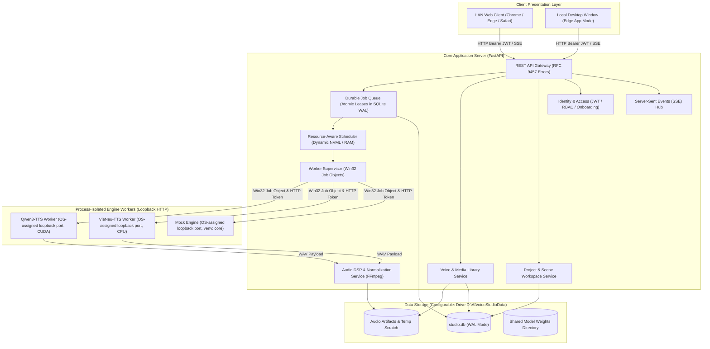

# TARGET SYSTEM ARCHITECTURE & TOPOLOGY DESIGN (REVISION R1)
**Project:** AI Voice Studio — Professional Modular AI Platform  
**Document ID:** ARCH-TGT-001-R1  
**Status:** R1.1 — PROPOSED / PENDING OWNER APPROVAL (documentation revision only)  
**Date:** October 2026  

> **Canonical contract:** [CANONICAL_CONTRACTS.md](CANONICAL_CONTRACTS.md). This R1.1 text is a design proposal, not evidence of implementation or measured performance. For contradictions, canonical contracts and accepted ADRs take precedence.

---

## 1. High-Level Architectural Overview

AI Voice Studio is built as a **Headless Core Modular Monolith** with **Process-Isolated AI Inference Workers** and a **Web-First Presentation Layer**.

```
+-----------------------------------------------------------------------------------------+
|                                    PRESENTATION LAYER                                   |
|   [Mode A: Windows Edge App Window (Local)]       [Mode B: Multi-User LAN Browser]      |
|                                                                                         |
|               React 19 + TypeScript + Vite + Tailwind CSS + shadcn/ui                   |
|                   TanStack Query v5 + Wavesurfer.js Audio Player                        |
+-----------------------------------------------------------------------------------------+
                                            │  HTTP / REST (Bearer JWT) + SSE Events
                                            ▼
+-----------------------------------------------------------------------------------------+
|                            APPLICATION CORE (FastAPI Monolith)                          |
|                                                                                         |
|   ┌───────────────────────────┐  ┌───────────────────────────┐  ┌───────────────────┐   |
|   │     Identity & Access     │  │     Project Workspace     │  │   Media Library   │   |
|   │ (Argon2id + RBAC Enforcer)│  │ (Scenes, Lines, Autosave) │  │ (Consent Gated)   │   |
|   └───────────────────────────┘  └───────────────────────────┘  └───────────────────┘   |
|   ┌───────────────────────────┐  ┌───────────────────────────┐  ┌───────────────────┐   |
|   │    Audio DSP Pipeline     │  │  Resource-Aware Scheduler │  │  Engine Registry  │   |
|   │ (FFmpeg / EBU R128 Norm.) │  │ (Dynamic NVML / GPU Mutex)│  │ (Manifest & SDK)  │   |
|   └───────────────────────────┘  └───────────────────────────┘  └───────────────────┘   |
|                                                                                         |
|             ┌─────────────────────────────────────────────────────────────┐             |
|             │     Durable Job Queue (SQLite WAL with Atomic Leases)       │             |
|             └─────────────────────────────────────────────────────────────┘             |
+-----------------------------------------------------------------------------------------+
                                            │  Authenticated Loopback HTTP (127.0.0.1)
                                            │  Token: X-Worker-Token | Win32 Job Object
                                            ▼
+-----------------------------------------------------------------------------------------+
|                         ISOLATED ENGINE WORKERS (Child Subprocesses)                    |
|                                                                                         |
|   ┌───────────────────────────┐  ┌───────────────────────────┐  ┌───────────────────┐   |
|   │     Mock Engine Worker    │  │     VieNeu-TTS Worker     │  │  Qwen3-TTS Worker │   |
|   │ (Unit/E2E Contract Tests) │  │  (ONNX Runtime CPU / 48kHz)│  │(PyTorch CUDA / 24k)│  |
|   │     venv: core/.venv      │  │   venv: vieneu/.venv      │  │ venv: qwen3/.venv │   |
|   └───────────────────────────┘  └───────────────────────────┘  └───────────────────┘   |
+-----------------------------------------------------------------------------------------+
```

---

## 2. Component Diagram & Internal Boundaries



---

## 3. Dynamic Resource-Aware Scheduling Architecture

The host RTX 3050 has 6GB nominal VRAM, but other desktop applications dynamically compete for this memory. The scheduling engine replaces static assumptions with an active feedback loop:

```mermaid
sequenceDiagram
    autonumber
    participant Q as Durable Job Queue
    participant Sched as Resource-Aware Scheduler
    participant NVML as NVIDIA NVML Telemetry
    participant Mutex as Global GPU Execution Lock
    participant Sup as Worker Supervisor
    participant Worker as Qwen3-TTS Worker (CUDA)

    Q->>Sched: Claim next job [Job Type: GPU]
    Sched->>Mutex: Try acquire GPU Execution Lock
    alt Lock busy
        Sched-->>Q: Hold job in QUEUED; wait for lock release
    else Lock acquired
        Sched->>NVML: Query current free VRAM & temperature
        NVML-->>Sched: Return: Free VRAM = X MB
        alt Free VRAM < measured model requirement + headroom
            Sched->>Mutex: Release GPU Lock
            Sched-->>Q: Hold job in QUEUED [Status: "Waiting for GPU memory"]
            Sched->>Sched: Exponential backoff delay (3s, 6s, 12s)
        else Sufficient VRAM Available
            Sched->>Sup: Dispatch job to Worker
            Sup->>Worker: POST /synthesize (Auth Header: X-Worker-Token)
            Worker-->>Sup: Stream Audio Result
            Sched->>Mutex: Release GPU Execution Lock
            Sched-->>Q: Job execution completed
        end
    end
```

---

## 4. End-to-End Data Flows (Revision R1)

### 4.1 Text-to-Speech Generation with Atomic Leases & Artifact Publication
```mermaid
sequenceDiagram
    autonumber
    actor Client as Web / Desktop Client
    participant API as FastAPI Gateway
    participant DB as SQLite WAL Database
    participant Sched as Scheduler & Supervisor
    participant Worker as Inference Worker
    participant DSP as FFmpeg DSP Pipeline
    participant Disk as Artifact File Storage

    Client->>API: POST /api/v1/jobs/speech (idempotency_key, text, voice_id)
    API->>DB: Check idempotency_key; Insert Job [Status: QUEUED]
    API-->>Client: 202 Accepted (job_id, status: QUEUED)

    loop Polling / Lease Claiming
        Sched->>DB: BEGIN IMMEDIATE; Claim job with lease (lease_expires_at = now + 15s)
    end

    Sched->>Worker: POST /synthesize (text, params)
    loop Every 5s
        Sched->>DB: Renew lease (heartbeat_at = now, lease_expires_at = now + 15s)
        Sched->>API: Emit SSE Progress Event (e.g. 45%)
    end

    Worker-->>Sched: Return raw audio buffer
    Sched->>DSP: Transcode & Loudness Normalization (EBU R128)
    DSP->>Disk: Write to temp scratch: data/artifacts/temp/job_123.tmp
    DSP->>DSP: Verify file header, checksum & size
    DSP->>Disk: Atomic Rename -> data/artifacts/exports/job_123.wav

    Sched->>DB: BEGIN IMMEDIATE; Update Job [Status: COMPLETED, artifact_id]
    Sched->>API: Emit SSE Event: job_completed
    API-->>Client: Event received; Waveform rendered; Play audio
```

---

## 5. Process Lifecycle & Orphan Cleanup on Windows

* **Win32 Job Objects:** Under Windows, child processes spawned by Python subprocesses do not automatically die if the parent crashes or is killed via Task Manager. The `WorkerSupervisor` registers all child worker processes into a **Windows Job Object** configured with `JOB_OBJECT_LIMIT_KILL_ON_JOB_CLOSE`. When configured correctly and the controlling process owns the Job Object handle, the OS terminates associated processes on the last handle close. The process-tree behavior must be verified on Windows, including nested subprocesses and abnormal termination.
* **Ephemeral Port Collision Prevention:** The supervisor passes `--port 0` to workers upon startup, allowing the Windows OS kernel to assign an unused ephemeral loopback port. The worker reports the OS-assigned port over a dedicated authenticated startup channel; the supervisor must test readiness and avoid port-discovery races. Static 5001/5002/5003 values in earlier diagrams are not normative.
