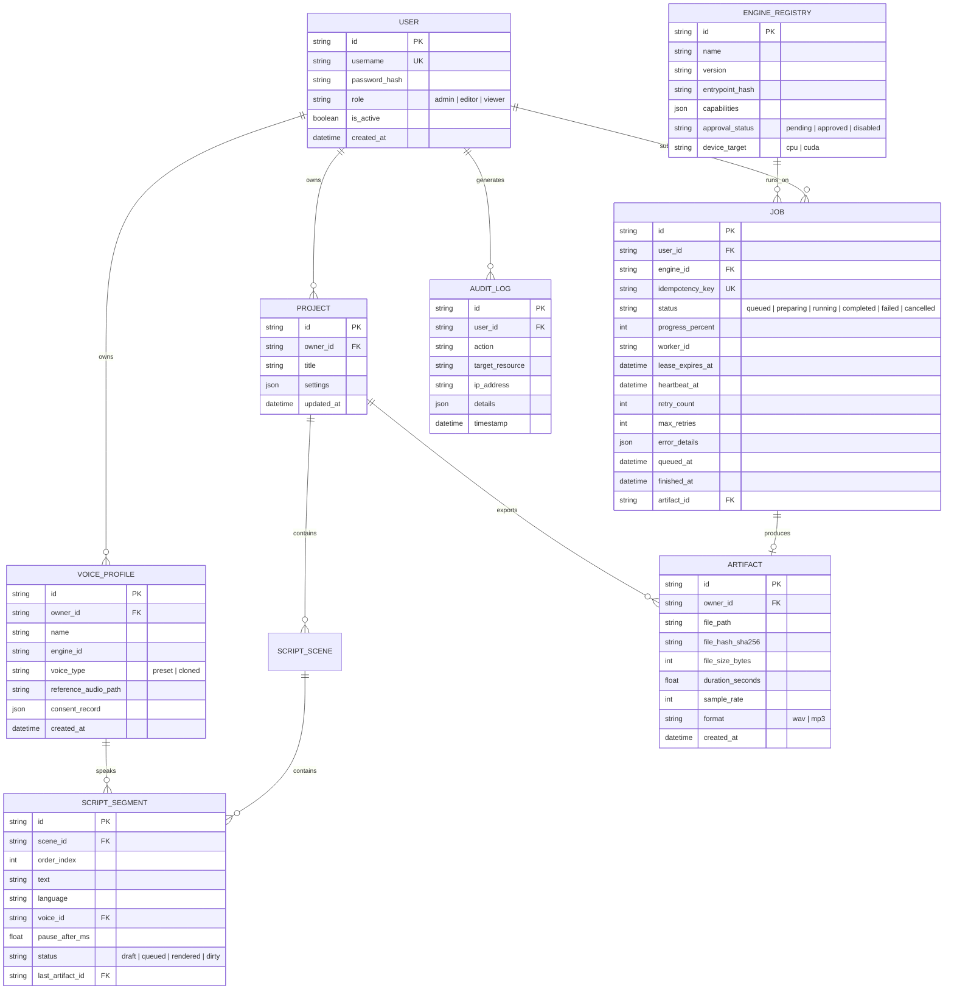

# API SPECIFICATION & DATA ARCHITECTURE DESIGN (REVISION R1)
**Project:** AI Voice Studio — Professional Modular AI Platform  
**Document ID:** ARCH-API-001-R1  
**Status:** REVISED ARCHITECTURE (R1) — AWAITING PHASE 1 AUTHORIZATION  
**Date:** October 2026  

---

## 1. REST API Design Principles (Revision R1)

1. **Strict Versioning:** Endpoints are rooted at `/api/v1/`. Breaking changes mandate a major version increment.
2. **Asynchronous Non-Blocking Semantics:** Long-running AI operations respond immediately with `202 Accepted` returning a `job_id`, polling location, and SSE event stream URI.
3. **RFC 9457 Standardized Errors:** All client errors (4xx) and server errors (5xx) return the `application/problem+json` media type complying with **RFC 9457**.
4. **Resilient SSE Streaming with Reconnects:** Server-Sent Events include incremental event IDs (`id: <seq>`). If a client drops connection, it reconnects using the `Last-Event-ID` header to resume state without polling.

---

## 2. Core API Endpoints Catalog

### 2.1 Identity, Onboarding & Security
* `GET /api/v1/auth/status` — Returns system bootstrap state (`needs_onboarding: true/false`).
* `POST /api/v1/auth/onboard` — Creates root Administrator account on initial setup.
* `POST /api/v1/auth/login` — Authenticates user with username/password, returns JWT token.
* `POST /api/v1/auth/refresh` — Refreshes expired session token.
* `GET /api/v1/auth/me` — Returns current authenticated user and permissions.

### 2.2 Engines & Models Management
* `GET /api/v1/engines` — List registered engines and their declared capabilities.
* `GET /api/v1/engines/{id}` — Detailed engine metadata and parameter schema.
* `POST /api/v1/engines/{id}/approve` — Admin authorization to enable discovered engine.
* `POST /api/v1/engines/{id}/unload` — Request worker to unload model weights from memory.

### 2.3 Projects & Dialogue Workspace
* `GET /api/v1/projects` — List projects owned by or shared with current user.
* `POST /api/v1/projects` — Create new project workspace.
* `GET /api/v1/projects/{id}` — Retrieve full project script, scenes, and segment statuses.
* `PUT /api/v1/projects/{id}` — Autosave script edits and character assignments.
* `POST /api/v1/projects/{id}/render` — Enqueue batch generation for all pending lines.
* `POST /api/v1/projects/{id}/export` — Master concatenate all segments into normalized WAV/MP3.

### 2.4 Voice Profiles & Consent Library
* `GET /api/v1/voices` — List available voices (preset voices + user-owned cloned profiles).
* `POST /api/v1/voices` — Upload reference audio, sign consent audit, create cloned voice profile.
* `GET /api/v1/voices/{id}` — Retrieve voice metadata and waveform preview URL.
* `DELETE /api/v1/voices/{id}` — Delete cloned voice profile and remove associated audio sample.

### 2.5 Inference Job Queue
* `POST /api/v1/jobs/speech` — Submit TTS job (Requires `idempotency_key`, text, voice_id).
* `POST /api/v1/jobs/clone` — Submit voice cloning job (Requires reference sample + text).
* `GET /api/v1/jobs/{id}` — Query current job state, lease info, execution logs.
* `POST /api/v1/jobs/{id}/cancel` — Abort a pending or running job.
* `GET /api/v1/jobs/{id}/events` — SSE stream for real-time progress and status updates.

### 2.6 Audio Artifacts & Streaming
* `GET /api/v1/artifacts/{id}` — Stream or download generated audio (`audio/wav` or `audio/mpeg`).
* `GET /api/v1/artifacts/{id}/waveform` — Returns pre-computed 100-point JSON waveform array for UI rendering.

---

## 3. Relational Database Schema (SQLite 3 WAL)



---

## 4. Atomic Job Leasing & Lifecycle Query Design

To prevent race conditions without external message brokers, workers claim jobs using SQLite's **immediate transaction isolation**:

```sql
-- Worker atomic job claim transaction
BEGIN IMMEDIATE;

UPDATE jobs
SET status = 'preparing',
    worker_id = :worker_id,
    lease_expires_at = datetime('now', '+15 seconds'),
    heartbeat_at = datetime('now')
WHERE id = (
    SELECT id FROM jobs
    WHERE status = 'queued'
       OR (status IN ('preparing', 'running') AND lease_expires_at < datetime('now'))
    ORDER BY queued_at ASC
    LIMIT 1
)
RETURNING id, engine_id, user_id, idempotency_key;

COMMIT;
```

### Zombie Reclaim & Expiry Logic
* The active worker must update `lease_expires_at = datetime('now', '+15 seconds')` every 5 seconds.
* If a worker process crashes, its lease expires. On the next scheduling cycle, another worker or the supervisor reclaims the job, increments `retry_count`, or transitions it to `FAILED` if `retry_count >= max_retries`.

---

## 5. Storage Hierarchy & Windows Permissions

All persistent storage paths are configurable via environment variable `STUDIO_DATA_DIR` (Defaulting to `D:\AIVoiceStudioData`):

```
D:\AIVoiceStudioData\
├── studio.db                      # Primary SQLite database
├── studio.db-wal                  # WAL write cache
├── backups/                       # Automated online database snapshots
│   └── studio_backup_20261008.db
├── models/                        # Pretrained model weights (Persists across app updates)
│   ├── vieneu/                    # ONNX checkpoints
│   └── qwen3-0.6b/                # PyTorch safetensors
├── voices/                        # Uploaded reference voice samples (UUID filenames)
│   └── 9b1deb4d-3b7d-4bad-9bdd-2b0d7b3dcb6d.wav
└── artifacts/                     # Generated audio files
    ├── temp/                      # Intermediate segment scratch files (GC after 7 days)
    │   └── scratch_job_123.tmp
    └── exports/                   # Master final exported tracks
        └── prj_48a7f_master.wav
```

### Windows Security & File Access Controls
* Filesystem permissions on `STUDIO_DATA_DIR` are restricted exclusively to the executing user account and Administrators (Access Control List: `icacls D:\AIVoiceStudioData /inheritance:r /grant:r "%USERNAME%":(OI)(CI)F`).
* Every file upload is assigned a non-enumerable UUIDv4; path traversal (`../`) is blocked by verifying that `Path(target).resolve().is_relative_to(STUDIO_DATA_DIR)`.
