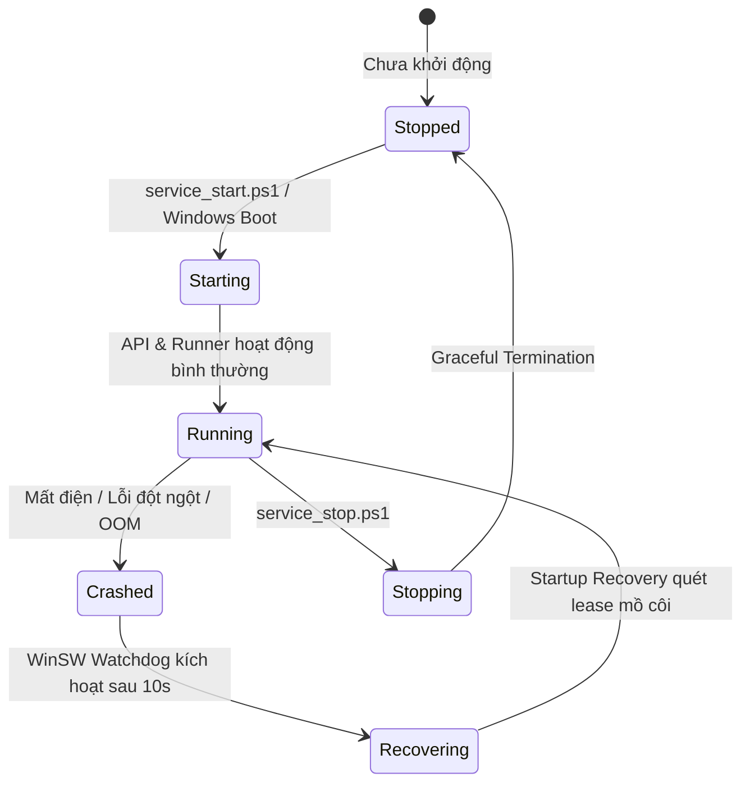

# Decision record: ADR-0012: Windows Service Management & Crash Recovery Lifecycle

## Background / problem
Trong các giai đoạn phát triển trước, ứng dụng AI Voice Studio được khởi động thủ công thông qua lệnh terminal (`python -m apps.server.src.main`).
Cách tiếp cận này bộc lộ các hạn chế nghiêm trọng trong vận hành phòng thu:
1. Khi người quản trị tắt cửa sổ PowerShell hoặc đăng xuất khỏi phiên làm việc (Windows User Logoff), tiến trình máy chủ bị tắt theo, làm gián đoạn truy cập của toàn bộ người dùng trong mạng LAN.
2. Khi máy trạm bị mất điện đột ngột hoặc tự động cập nhật Windows (Windows Update Reboot), hệ thống không tự động khởi chạy lại.
3. Nếu một trong hai tiến trình (`main.py` hoặc `runner.py`) gặp lỗi sập bất thường (Crash / Out-of-memory), không có cơ chế tự động khởi động lại (Process Watchdog).

## Scope and exclusions
- **Trong phạm vi:** Đăng ký và quản lý 2 tiến trình cốt lõi của hệ thống dưới dạng **Windows Services**:
  - Dịch vụ 1: `AIVoiceStudio_API` (Chạy Uvicorn FastAPI Server).
  - Dịch vụ 2: `AIVoiceStudio_Runner` (Chạy Standalone Durable Job Runner & Worker Supervisor).
  - Thiết lập cơ chế tự phục hồi sau sự cố sập (Automatic Restart on Failure).
  - Cung cấp kịch bản quản trị bằng PowerShell chuẩn hóa.
- **Ngoại trừ:** Không yêu cầu quyền chạy trên môi trường Windows Server thương mại đa cụm; tối ưu hóa cho Windows 11 Workstation Pro/Home.

## Proposed approach / options

### Phương án A (Được đề xuất): WinSW (Windows Service Wrapper)
- **Đặc điểm:** Công cụ wrapper mã nguồn mở tiêu chuẩn công nghiệp được sử dụng rộng rãi (Jenkins, SonarQube), hoạt động độc lập bằng một tệp `.exe` nhỏ gọn kèm theo tệp cấu hình `.xml`.
- **Ưu điểm:**
  - Cấu hình XML tường minh, lưu trực tiếp trong thư mục cấu hình của dự án (`deploy/windows/`).
  - Hỗ trợ đầy đủ các tính năng nâng cao: Ghi nhật ký xoay vòng (Log Rotation: rolling-size), thiết lập biến môi trường, định nghĩa hành vi khi tiến trình con sập (`<onfailure action="restart" delay="10 sec"/>`).
  - Dễ dàng cài đặt và gỡ bỏ hoàn toàn thông qua lệnh PowerShell mà không can thiệp sâu vào Registry.

### Phương án B: NSSM (Non-Sucking Service Manager)
- **Đặc điểm:** Tương tự WinSW nhưng cấu hình lưu trong Windows Registry thay vì tệp XML; khó kiểm soát phiên bản qua Git và không tiện bảo trì bằng mã nguồn mở.

### Phương án C: Windows Task Scheduler
- **Đặc điểm:** Tạo lịch chạy khi máy khởi động (At Startup).
- **Nhược điểm:** Không có cơ chế giám sát sức khỏe tiến trình thời gian thực; không tự động khởi động lại khi tiến trình con bị crash đột ngột; khó tích hợp logging xoay vòng.

## Thiết kế vòng đời và Phục hồi sự cố (Recovery Lifecycle)

1. **Khôi phục nhiệm vụ khi khởi động lại (`recover_on_startup`)**:
   Khi tiến trình `AIVoiceStudio_Runner` được WinSW khởi động lại, hàm `DurableQueueService.recover_on_startup()` sẽ tự động rà soát toàn bộ bảng `jobs`:
   - Các job ở trạng thái `RUNNING` hoặc `PREPARING` có khóa `locked_by` cũ sẽ được kiểm tra.
   - Nếu số lần thử `attempt_count < max_retries`, job được chuyển về `QUEUED` để tiếp tục thực thi an toàn.
   - Nếu đã vượt quá `max_retries`, chuyển sang `FAILED` kèm lý do lỗi rõ ràng, tránh lặp vô tận.

## Risks / security / operations
- **Quyền hạn Windows**: Việc đăng ký Windows Service yêu cầu quyền Quản trị viên (Run as Administrator) một lần duy nhất lúc cài đặt. Các script quản trị sẽ tự động kiểm tra `IsAdministrator` và đưa ra thông báo hướng dẫn rõ ràng.
- **Cách ly tài nguyên**: Tiến trình Runner tiếp tục sử dụng **Windows Job Objects** để cô lập hoàn toàn các Worker con nơ-ron (VieNeu, Qwen3), đảm bảo khi dịch vụ Runner dừng thì toàn bộ tiến trình con AI cũng được dọn dẹp sạch sẽ.

## Acceptance & evidence
- [ ] Dịch vụ tự động khởi chạy thành công sau khi khởi động lại máy trạm Windows mà không cần người dùng đăng nhập.
- [ ] Giả lập lệnh `Stop-Process -Force` trên tiến trình API: WinSW tự động khởi động lại tiến trình sau 10 giây.
- [ ] Job đang chạy dở trước khi crash được phục hồi về hàng đợi và hoàn thành tổng hợp âm thanh thành công.

## Decision / outcome / follow-up
- **Trạng thái:** **Proposed (Chờ Product Owner phê duyệt)**.
- **Kế hoạch liên quan:** [PHASE_05_DEPLOYMENT_SECURITY.md](../../plans/PHASE_05_DEPLOYMENT_SECURITY.md).
