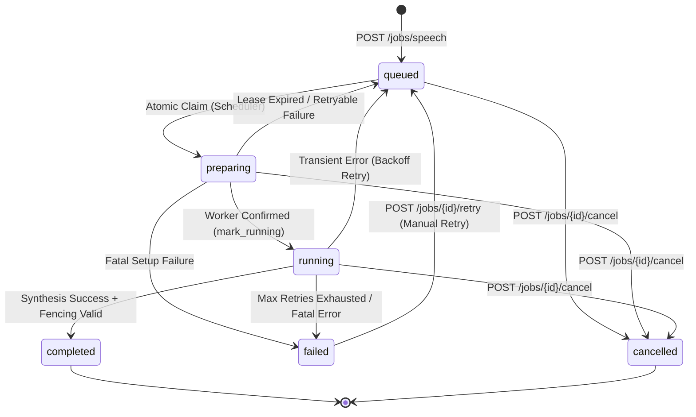

# Kế Hoạch Triển Khai Giai Đoạn 2: Hàng Đợi Bền Vững & Khả Năng Chống Chịu Sự Cố (Phase 2 Durable Queue Plan)

## 1. MỤC TIÊU & PHẠM VI (OBJECTIVES & BOUNDARIES)

Giai đoạn 2 xây dựng hạ tầng điều phối tác vụ suy luận AI chuẩn công nghiệp cho AI Voice Studio:
- **Nguyên tắc cốt lõi:** Bền vững trước sự cố nguồn/sập server, phân bổ tài nguyên có kiểm soát (Slot Limits), giao tiếp tiến độ thời gian thực (Server-Sent Events) và chống ghi đè dữ liệu cũ (Fencing Tokens).
- **Phạm vi cho phép (In Scope):**
  - Durable SQLite WAL Queue với cơ chế claim nguyên tử (Atomic Claim).
  - Máy trạng thái tác vụ (Durable Job State Machine: 6 trạng thái rõ ràng).
  - Quản lý tài nguyên phần cứng (Resource Manager: max 1 GPU job, max 1 CPU job).
  - Fencing Token (`current_attempt_id`) loại bỏ hiện tượng stale worker ghi đè artifact.
  - Bộ lập lịch độc lập (Independent Scheduler Daemon) chạy trong FastAPI lifespan.
  - Tự khôi phục sau sự cố khởi động lại máy chủ (Startup Crash Recovery).
  - Server-Sent Events (SSE) streaming hỗ trợ `Last-Event-ID` và xác thực qua query token.
  - Nút Hủy (Cancel) và Thử lại (Retry) trên giao diện Web UI, duy trì trạng thái qua F5 reload.
- **Ngoài phạm vi (Out of Scope):**
  - Không cài đặt Redis hoặc Celery (tuân thủ Modular Monolith trên SQLite WAL).
  - Không triển khai engine thực tế VieNeu hay Qwen3 (tiếp tục sử dụng Contract Mock Engine; adapter thực tế dành cho Phase 3).
  - Không cấu hình mạng LAN, Firewall, TLS hay Windows Services.

---

## 2. KIẾN TRÚC & MÁY TRẠNG THÁI (STATE MACHINE SPECIFICATION)

### Bảng chuyển đổi trạng thái hợp lệ:
| Từ trạng thái | Đến trạng thái hợp lệ | Điều kiện / Tác nhân |
|:---|:---|:---|
| `queued` | `preparing`, `cancelled` | Được Scheduler claim; hoặc người dùng hủy |
| `preparing` | `running`, `queued`, `failed`, `cancelled` | Worker bắt đầu; hết hạn lease retry; lỗi fatal; hoặc hủy |
| `running` | `completed`, `queued`, `failed`, `cancelled` | Thành công; lỗi tạm thời retry; kiệt số lần thử; hoặc hủy |
| `failed` | `queued` | Chỉ được phép qua endpoint `POST /jobs/{id}/retry` |
| `completed` | *(Terminal)* | Không cho phép chuyển đổi |
| `cancelled` | *(Terminal)* | Không cho phép chuyển đổi |

Mọi chuyển đổi trái phép kích hoạt ngoại lệ `IllegalStateTransitionError` trả về RFC 9457 mã lỗi `ILLEGAL_STATE_TRANSITION` (HTTP 400).

---

## 3. CHI TIẾN THUẬT GIAO DỊCH VÀ KHẢ NĂNG PHỤC HỒI

1. **Giao dịch SQLite ngắn hạn (Short Transactions):**
   - Không bao giờ giữ write lock SQLite trong suốt thời gian worker suy luận âm thanh.
   - Luồng: `Claim (Commit) -> Synthesize (Outside DB) -> Heartbeat (Fast Commit) -> Complete (Commit)`.
2. **Nguyên tử hóa việc nhận tác vụ (Atomic Claiming):**
   - Sử dụng câu lệnh UPDATE có điều kiện với `current_attempt_id = UUID` và `attempt_count + 1`.
3. **Phân bổ tài nguyên an toàn (Defensive Slot Allocator):**
   - Khóa chặt tối đa 1 GPU job trên card RTX 3050 6GB; tác vụ sau phải xếp hàng với lý do `Awaiting GPU slot`.
4. **Fencing Token (`current_attempt_id`):**
   - Ngăn chặn triệt để tình huống worker cũ chạy chậm cố tình ghi đè kết quả khi lease đã bị thu hồi và giao cho worker mới.
