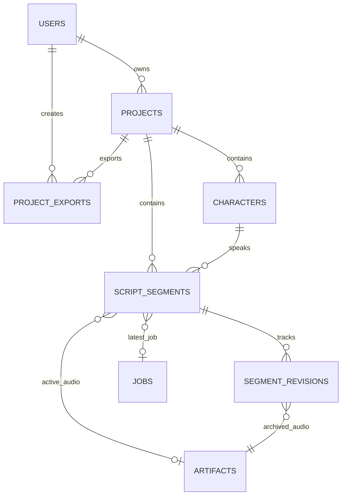

# AI VOICE STUDIO — KẾ HOẠCH TRIỂN KHAI TỔNG THỂ PHASE 4
## MASTER IMPLEMENTATION PLAN: PROFESSIONAL STUDIO UX, LONG-FORM TTS, DIALOGUE WORKSPACE & AUDIO MASTERING

- **Mã kế hoạch:** `PLAN-PHASE-04-STUDIO`
- **Tác giả:** Principal Software Architect, Senior Full-Stack Engineer, Audio DSP Engineer & QA Lead
- **Ngày lập:** 2026-10-08
- **Trạng thái:** ACCEPTED FOR EXECUTION (Được phê duyệt triển khai)
- **Baseline kiến trúc:** Architecture R1.1 (ADR-0001 đến ADR-0009)
- **Git Commit gốc:** `ae4857e` (Phase 3 Acceptance Gate PASS)
- **Phạm vi được cấp phép:** **CHỈ PHASE 4** (Nghiêm cấm triển khai Phase 5, mạng LAN hay mở rộng hạ tầng ngoài phạm vi).

---

## 1. MỤC TIÊU VÀ TẦM NHÌN SẢN PHẨM (PRODUCT OBJECTIVE)

Chuyển đổi AI Voice Studio từ một giao diện kiểm thử mô hình nơ-ron kỹ thuật thành một **ứng dụng trạm làm việc sáng tạo nội dung âm thanh chuyên nghiệp (Professional Audio Workstation)** chạy hoàn toàn cục bộ trên máy trạm Windows 11.

### Các luồng quy trình sáng tạo mục tiêu (Target Workflows):
1. **Long-form Narration Studio:** Tự sự dài tập, đọc sách nói (audiobook), bài báo, phóng sự bằng tiếng Việt (VieNeu 48kHz) và tiếng Trung (Qwen3 24kHz).
2. **Dialogue Studio:** Kịch bản kịch truyền thanh, hội thoại nhiều nhân vật, phối hợp đa dạng giọng đọc giữa các nhân vật trong cùng một bối cảnh (kể cả kết hợp nhân vật nói tiếng Việt và nhân vật nói tiếng Trung).
3. **Phân đoạn văn bản thông minh (Intelligent Text Segmentation):** Tự động phân chia văn bản dài theo câu và đoạn văn tự nhiên, tôn trọng cấu trúc ngữ nghĩa tiếng Việt và tiếng Trung, tránh quá tải độ dài suy luận của mô hình AI.
4. **Chỉnh sửa & Tái tạo một phần (Partial Invalidation & Regeneration):** Cho phép sửa văn bản ở từng câu/đoạn cụ thể mà **chỉ phải render lại duy nhất đoạn đó**, bảo toàn 100% các đoạn âm thanh khác đã sinh trước đó mà không phải render lại toàn bộ dự án.
5. **Quản lý phiên bản âm thanh không phá hủy (Non-destructive Audio Versioning):** Khi một đoạn được render lại, âm thanh cũ không bị xóa mất mà được lưu giữ vào lịch sử phiên bản (`segment_revisions`) để người dùng có thể nghe so sánh hoặc hoàn tác.
6. **Lắp ráp & Xuất bản âm thanh chuyên nghiệp (Audio DSP & Mastering):** Ghép nối các đoạn âm thanh khác nhau về tần số mẫu (VieNeu 48kHz, Qwen3 24kHz) một cách mượt mà, chèn khoảng lặng chính xác, chuẩn hóa âm lượng theo chuẩn phát thanh (EBU R128), và xuất ra các tệp WAV/MP3 chất lượng cao có kiểm định toàn vẹn.

---

## 2. CHIẾN LƯỢC TRIỂN KHAI PHÂN TẦNG (4 MILESTONES)

Dự án chia nhỏ Phase 4 thành 4 mốc (Milestones) độc lập, kiểm thử chặt chẽ qua từng mốc trước khi tạo commit Git:

```
[Milestone 4A: Project Workspace & UX Foundation]
  ├── Database Schema & Migration (projects, characters, script_segments, segment_revisions, project_exports)
  ├── Optimistic Concurrency Control (Version checks, autosave an toàn chống ghi đè)
  ├── Project Management API (CRUD projects, scenes, characters)
  └── Modern Studio Layout & Navigation (Project Dashboard, Breadcrumbs, Tab navigation)
       ↓
[Milestone 4B: Long-form Speech Studio]
  ├── Intelligent Text Segmenter (Sentence boundary, punctuation-preserving cho VI và ZH)
  ├── Segment List Editor (In-place text edit, reorder, add, delete, split, merge)
  ├── Batch & Partial Synthesis (Queue batch jobs, track segment render states, stale flag)
  └── Non-destructive Audio Player (Listen segment audio, version switcher, waveform indicator)
       ↓
[Milestone 4C: Dialogue Studio]
  ├── Multi-Speaker Scripting (Add/edit characters, avatar colors, assign engine/voice/cloned-asset)
  ├── Speaker Assignment per Line (Dropdown speaker, dynamic language & voice indicator)
  ├── Timing & Pause Controls (Custom pause_after_ms per segment)
  └── Mixed-Engine Timeline (View mixed VieNeu 48kHz + Qwen3 24kHz script timeline)
       ↓
[Milestone 4D: Audio DSP, Mastering, Export & Full Gate Acceptance]
  ├── Safe Audio DSP Pipeline (FFmpeg subprocess without shell injection, sample rate conversion)
  ├── Silence Padding & Boundary Smoothing (Crossfade, seamless stitching)
  ├── EBU R128 Loudness Normalization & Quality Presets (WAV 16-bit/24-bit, MP3 320kbps LAME)
  ├── Full Regression Suite (Tier 1 Fast CI + Tier 2 Hardware Integration)
  ├── Chrome Browser Playwright E2E Tests (Workflows A, B, C, D)
  └── Verification Reports, Backup & Git Bundle
```

---

## 3. THIẾT KẾ CƠ SỞ DỮ LIỆU & SCHEMA MIGRATION (ALEMBIC)

Hệ thống bổ sung 5 bảng thực thể mới thông qua migration `20261008_0004_phase4_studio.py`, đảm bảo toàn vẹn khóa ngoại (Foreign Keys) và không làm mất bất kỳ dữ liệu nào đã có từ Phase 1, 2, 3:



### Chi tiết các bảng:
1. **`projects`**:
   - `id`: VARCHAR(36) PK
   - `user_id`: VARCHAR(36) FK -> `users.id`
   - `title`: VARCHAR(255) NOT NULL
   - `description`: TEXT NULLABLE
   - `project_type`: VARCHAR(50) NOT NULL (`'narration'` hoặc `'dialogue'`)
   - `settings`: JSON NOT NULL (chứa `target_sample_rate`, `default_pause_ms`, `mastering_preset`)
   - `version`: INTEGER NOT NULL DEFAULT 1 (Optimistic locking cho autosave)
   - `created_at`: DATETIME, `updated_at`: DATETIME

2. **`characters`**:
   - `id`: VARCHAR(36) PK
   - `project_id`: VARCHAR(36) FK -> `projects.id` ON DELETE CASCADE
   - `name`: VARCHAR(100) NOT NULL
   - `avatar_color`: VARCHAR(20) NOT NULL (mã màu HEX phân biệt)
   - `engine_id`: VARCHAR(50) NOT NULL FK -> `engines.id`
   - `voice_id`: VARCHAR(100) NOT NULL
   - `language`: VARCHAR(10) NOT NULL (`'vi'` hoặc `'zh'`)
   - `parameters`: JSON NOT NULL (tốc độ, tham chiếu cloning...)
   - `sort_order`: INTEGER NOT NULL DEFAULT 0
   - `created_at`, `updated_at`

3. **`script_segments`**:
   - `id`: VARCHAR(36) PK
   - `project_id`: VARCHAR(36) FK -> `projects.id` ON DELETE CASCADE
   - `character_id`: VARCHAR(36) NULLABLE FK -> `characters.id` ON DELETE SET NULL
   - `sequence_order`: INTEGER NOT NULL (Thứ tự trong kịch bản)
   - `text`: TEXT NOT NULL (Nội dung câu nói/đoạn văn)
   - `language`: VARCHAR(10) NOT NULL
   - `engine_id`: VARCHAR(50) NOT NULL FK -> `engines.id`
   - `voice_id`: VARCHAR(100) NOT NULL
   - `parameters`: JSON NOT NULL
   - `pause_after_ms`: INTEGER NOT NULL DEFAULT 300 (Khoảng lặng sau câu)
   - `status`: VARCHAR(20) NOT NULL DEFAULT `'draft'` (`'draft'`, `'queued'`, `'rendering'`, `'completed'`, `'failed'`, `'stale'`)
   - `active_artifact_id`: VARCHAR(36) NULLABLE FK -> `artifacts.id` ON DELETE SET NULL
   - `last_job_id`: VARCHAR(36) NULLABLE FK -> `jobs.id` ON DELETE SET NULL
   - `text_hash`: VARCHAR(64) NOT NULL (SHA-256 nội dung để phát hiện thay đổi)
   - `version`: INTEGER NOT NULL DEFAULT 1
   - `created_at`, `updated_at`

4. **`segment_revisions`**:
   - `id`: VARCHAR(36) PK
   - `segment_id`: VARCHAR(36) FK -> `script_segments.id` ON DELETE CASCADE
   - `revision_number`: INTEGER NOT NULL
   - `text`: TEXT NOT NULL
   - `engine_id`: VARCHAR(50) NOT NULL
   - `voice_id`: VARCHAR(100) NOT NULL
   - `parameters`: JSON NOT NULL
   - `artifact_id`: VARCHAR(36) NOT NULL FK -> `artifacts.id` ON DELETE CASCADE
   - `job_id`: VARCHAR(36) NULLABLE FK -> `jobs.id`
   - `duration_seconds`: FLOAT NOT NULL
   - `created_at`: DATETIME

5. **`project_exports`**:
   - `id`: VARCHAR(36) PK
   - `project_id`: VARCHAR(36) FK -> `projects.id` ON DELETE CASCADE
   - `user_id`: VARCHAR(36) FK -> `users.id`
   - `format`: VARCHAR(10) NOT NULL (`'wav'`, `'mp3'`)
   - `sample_rate`: INTEGER NOT NULL (e.g. 48000, 44100, 24000)
   - `file_path`: VARCHAR(500) NOT NULL
   - `file_size_bytes`: INTEGER NOT NULL
   - `duration_seconds`: FLOAT NOT NULL
   - `sha256_checksum`: VARCHAR(64) NOT NULL
   - `loudness_lufs`: FLOAT NULLABLE (Đo lường EBU R128)
   - `segment_count`: INTEGER NOT NULL
   - `created_at`: DATETIME

---

## 4. THIẾT KẾ GIAO DIỆN NGƯỜI DÙNG CHUYÊN NGHIỆP (STUDIO UX / UI)

Xây dựng trên nền tảng React + TypeScript + Tailwind CSS hiện có với tính thẩm mỹ của một Digital Audio Workstation (DAW) hiện đại:

1. **Thanh điều hướng cấp ứng dụng (Top Application Navigation Bar):**
   - Bộ chọn dự án nhanh (Project Switcher) và tiêu đề dự án đang mở kèm trạng thái lưu (Saved / Autosaving / Unsaved changes).
   - Chuyển đổi không gian làm việc (Workspace Tabs):
     - **Dự án (Projects Dashboard)**
     - **Speech Studio (Tự sự / Long-form Narration)**
     - **Dialogue Studio (Hội thoại đa nhân vật)**
     - **Kho giọng & Mẫu âm thanh (Voice Library & Cloned Assets)**
     - **Lịch sử & Xuất bản (Exports & History)**
   - Thông tin người dùng hiện tại & nút Đăng xuất.

2. **Long-form Speech Studio Workspace:**
   - **Thanh công cụ đỉnh:** Nút "Phân đoạn văn bản" (Auto Segment), "Sinh tất cả" (Render All Missing/Stale), "Xuất bản" (Export Master Audio), thanh đo tổng thời lượng dự kiến.
   - **Khu vực kịch bản dạng khối (Segment Block Timeline):**
     - Mỗi segment là một thẻ độc lập có số thứ tự câu.
     - Ô nhập văn bản hỗ trợ in-place editing, tự động co giãn dòng.
     - Thẻ trạng thái trực quan: `Bản nháp (Draft)`, `Cần tạo lại (Stale/Modified)`, `Đang chờ (Queued)`, `Đang xử lý (Rendering)`, `Hoàn thành (Completed)`.
     - Bộ phát mini (mini audio player) cho từng segment có sóng âm (waveform placeholder), nút phát nghe thử, thời lượng (s).
     - Nút "Tạo lại đoạn này" (Regenerate Line), menu xem lịch sử các bản thu trước (Audio Revisions).
     - Điều khiển khoảng lặng (Pause duration control: 200ms, 500ms, 1000ms...).

3. **Dialogue Studio Workspace:**
   - **Bảng quản lý Nhân vật (Character Sidebar / Drawer):**
     - Danh sách nhân vật với màu sắc nhận diện trực quan (Badge color).
     - Cấu hình từng nhân vật: Tên, Mô hình AI (VieNeu CPU vs Qwen3 GPU), Giọng đọc (Preset hoặc Cloned Voice Asset), Tốc độ nói.
   - **Dòng kịch bản thoại (Dialogue Script Stream):**
     - Mỗi câu thoại gắn liền với Avatar và tên Nhân vật.
     - Cho phép đổi nhanh người nói cho câu thoại qua dropdown.
     - Hỗ trợ câu thoại tiếng Việt và tiếng Trung đan xen nhau mượt mà.
     - Nghe thử từng câu hoặc nghe liên tục toàn bộ kịch bản.

4. **Hộp thoại Xuất bản Âm thanh (Audio Mastering & Export Modal):**
   - Định dạng: WAV (Lossless PCM 16-bit / 24-bit) hoặc MP3 (320kbps).
   - Tần số mẫu đích: 48,000 Hz (Khuyến nghị chuẩn phòng thu) hoặc 44,100 Hz (Chuẩn CD Audio) hoặc 24,000 Hz.
   - Chuẩn hóa âm lượng:
     - Tùy chọn 1: Giữ nguyên dải động tự nhiên (Native dynamic range).
     - Tùy chọn 2: Chuẩn hóa EBU R128 (-16 LUFS cho Podcast / Web, -23 LUFS cho Truyền hình).
   - Tiến trình lắp ráp (Stitching progress bar) và nút tải tệp về máy tính ngay sau khi hoàn tất.

---

## 5. THIẾT KẾ AUDIO DSP VÀ QUY TRÌNH MASTERING AN TOÀN

### 5.1. Thuật toán phân đoạn văn bản thông minh (Text Segmentation)
- **Tiếng Việt:**
  - Tách đoạn theo `\n+`.
  - Phân tách câu theo dấu kết thúc: `[.?!;]+` kèm khoảng trắng hoặc ngắt dòng.
  - Xử lý ngoại lệ (Regex Negative Lookbehind): Không ngắt câu tại các từ viết tắt phổ biến ("TP.", "ThS.", "TS.", "PGS.", "GS.", "v.v.", "ông.", "bà.") hoặc số thập phân ("3.14", "1.5").
  - Gộp các cụm từ quá ngắn (< 15 ký tự) vào câu trước nếu câu trước chưa vượt quá 200 ký tự.
  - Ngưỡng tối ưu: 60 - 250 ký tự mỗi đoạn (phù hợp tuyệt đối với vùng suy luận ổn định của VieNeu-TTS).
- **Tiếng Trung:**
  - Tách câu theo dấu câu chuẩn tiếng Trung: `[。！？；]+`.
  - Ngưỡng tối ưu: 30 - 120 ký tự mỗi câu (phù hợp với Qwen3-TTS).

### 5.2. Đường ống DSP âm thanh (DSP Audio Pipeline)
Sử dụng công cụ `ffmpeg` phiên bản 7.1.1 có sẵn trên máy trạm Windows tại `C:\Program Files\Piu Downloader\ffmpeg.exe` (được cấu hình an toàn qua `apps/server/src/config.py` và auto-discovery):
1. **Kiểm tra đầu vào:** Toàn bộ các segments phải ở trạng thái `completed` và có `active_artifact_id` trỏ đến tệp WAV hợp lệ. Bất kỳ đoạn nào lỗi sẽ bị cảnh báo và từ chối xuất master nhằm tránh việc mất mát câu thoại âm thầm.
2. **Bộ lọc ghép nối an toàn (Filter Graph Concat):**
   - Đọc từng tệp segment WAV đầu vào qua pipe an toàn (không dùng chuỗi shell để chống injection).
   - Chèn khoảng lặng `aevalsrc=0:d={pause_duration_s}` hoặc filter `apad` sau mỗi đoạn.
   - Chuẩn hóa sample rate với bộ lọc chất lượng cao `aresample=48000:resample_cutoff=0.99`.
   - Chuẩn hóa kênh âm thanh: Đưa về Mono hoặc Stereo nhất quán.
   - Áp dụng bộ lọc `loudnorm=I=-16:TP=-1.5:LRA=11` nếu người dùng bật tùy chọn chuẩn hóa EBU R128.
3. **Mã hóa đầu ra:**
   - WAV: `-c:a pcm_s16le`
   - MP3: `-c:a libmp3lame -b:a 320k`
4. **Kiểm tra tính toàn vẹn (Integrity Check):** Đo lại độ dài tệp, phân tích header và tính mã băm SHA-256 lưu vào bảng `project_exports`.

---

## 6. PHÂN TÍCH RỦI RO & PHÒNG NGỪA (RISK ASSESSMENT)

| Rủi ro kỹ thuật | Mức độ | Biện pháp phòng ngừa và xử lý |
| :--- | :---: | :--- |
| **Ghi đè kịch bản do Autosave đồng thời (Race condition)** | Cao | Sử dụng Optimistic Concurrency Control với trường `version` trong bảng `projects` và `script_segments`. Nếu client gửi version cũ hơn DB, trả về HTTP `409 Conflict` để UI cảnh báo người dùng. |
| **Mất mát câu thoại khi xuất Master Audio** | Cao | Master Export bắt buộc kiểm tra 100% segments đều đã hoàn thành. Nếu có segment ở trạng thái `stale`, `failed` hoặc `draft`, hệ thống chặn xuất và trả về danh sách chính xác các câu cần tạo lại. |
| **Khác biệt tần số lấy mẫu (48kHz vs 24kHz)** | Trung bình | Sử dụng bộ lọc `aresample` chất lượng cao trong FFmpeg để đồng nhất trước khi ghép. Ghi rõ trong tài liệu rằng việc resample 24kHz lên 48kHz là để đồng bộ kỹ thuật, không làm tăng độ trung thực vốn có của mô hình 24kHz. |
| **Nghẽn hàng đợi khi sinh hàng loạt (Batch queue saturation)** | Trung bình | Giới hạn số lượng tác vụ queued theo từng dự án; tận dụng cơ chế chia sẻ slot tài nguyên đã hoàn thiện ở Phase 2 (1 GPU slot cho Qwen3, 1 CPU slot cho VieNeu). |
| **Filesystem Command Injection qua tên tệp xuất** | Nghiêm trọng | Không dùng chuỗi lệnh shell. Sử dụng mảng danh sách tham số trực tiếp `subprocess.run(["ffmpeg", ...], shell=False)`. Mọi tệp trung gian và tệp xuất đều được định danh bằng UUID do hệ thống sinh ra. |

---

## 7. TIÊU CHÍ CHẤP THUẬN NGHIỆM THU (ACCEPTANCE CRITERIA)

1. **Quản lý dự án bền vững:** Tạo, mở, lưu, đổi tên và xóa dự án thành công; dữ liệu kịch bản và phân vai nhân vật sống sót qua việc đóng trình duyệt và khởi động lại API server.
2. **Long-form Speech Studio:** Dán văn bản nhiều đoạn tiếng Việt/tiếng Trung -> Tự động phân đoạn chính xác -> Sinh hàng loạt -> Sửa 1 câu -> Chỉ câu đó chuyển sang `stale` -> Tái tạo câu đó thành công mà không ảnh hưởng các câu khác.
3. **Dialogue Studio:** Định nghĩa nhiều nhân vật -> Gán giọng VieNeu cho nhân vật Việt, Qwen3 cho nhân vật Trung -> Kịch bản đan xen thoại -> Render thành công -> Nghe thử mượt mà.
4. **Master Audio Export:** Xuất tệp WAV 48kHz và MP3 320kbps hoàn chỉnh, có khoảng lặng nối câu chính xác, đo đạc SHA-256 và lưu vết lịch sử trong `project_exports`.
5. **Kiểm thử tự động:** Vượt qua 100% bộ kiểm thử 2 tầng (Tier 1 Fast CI và Tier 2 Hardware Integration).
6. **Playwright E2E Browser Tests:** Vượt qua 4 kịch bản quy trình làm việc (Workflows A, B, C, D) với ảnh chụp màn hình minh chứng chân thực.
