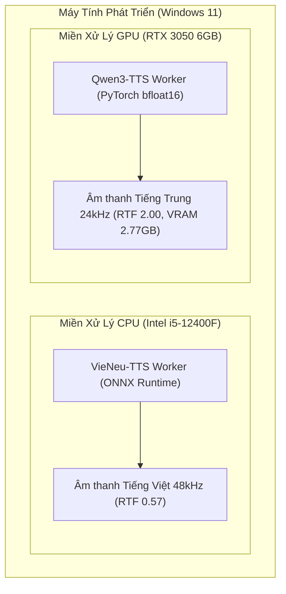

# AI VOICE STUDIO — SO SÁNH HIỆU NĂNG & NĂNG LỰC ĐỘNG CƠ (PHASE 1B COMPARISON)

**Kỹ sư phụ trách:** Lead AI/ML Infrastructure Engineer  
**Ngày thực hiện:** 2026-10-08  
**Phạm vi:** Đối chiếu trực tiếp giữa Engine A (VieNeu-TTS v3 Turbo) và Engine B (Qwen3-TTS 0.6B CustomVoice)  

---

## 1. BẢNG SO SÁNH TỔNG HỢP (HEAD-TO-HEAD MATRIX)

| Tiêu chí so sánh | Engine A: VieNeu-TTS v3 Turbo | Engine B: Qwen3-TTS 0.6B CustomVoice |
|:---|:---|:---|
| **Ngôn ngữ mục tiêu** | **Tiếng Việt (vi)** (Bắc, Trung, Nam) | **Tiếng Trung (zh)** (Mandarin, Dialects) |
| **Phần cứng mục tiêu** | **CPU** (Intel Core i5-12400F) | **GPU** (NVIDIA RTX 3050 6GB VRAM) |
| **Backend suy luận** | ONNX Runtime (Torch-Free) | PyTorch 2.6.0+cu124 (CUDA `sm_86`) |
| **Độ chính xác số học** | `FP32` | `torch.bfloat16` |
| **Dung lượng trọng số** | ~1.1 GB (ONNX + MOSS Codec) | ~2.3 GB (SafeTensors + Tokenizer) |
| **Tần số lấy mẫu (Sample Rate)** | **`48,000 Hz`** (Studio High-Res) | **`24,000 Hz`** (Chuẩn Tokenizer 12Hz) |
| **Thời gian nạp mô hình (Cold Load)** | `59.87s` (Bao gồm fetch weights) | `844.38s` (Tải weights lần đầu ~2.5GB) |
| **Tốc độ sinh (Warm RTF)** | **`0.55 – 0.75`** *(Nhanh hơn thời gian thực)* | **`1.87 – 2.06`** *(Chậm hơn thời gian thực ~2x)* |
| **Bộ nhớ RAM tiêu thụ** | Đỉnh: **`2,440 MB`** RAM hệ thống | RAM hệ thống: `~1.5 GB` |
| **Bộ nhớ VRAM tiêu thụ** | **`0 MB`** (Không dùng GPU) | Đỉnh: **`2,772 MB`** (Chiếm ~45% VRAM 6GB) |
| **Tính năng giọng dựng sẵn** | 25 giọng 3 miền Bắc/Trung/Nam | 9 giọng (Vivian, Uncle_Fu, Serena,...) |
| **Tính năng Voice Cloning** | Hỗ trợ 3-5s Zero-shot cloning | Không (CustomVoice là fixed-speaker) |
| **Giấy phép bản quyền** | **Apache-2.0** | **Apache-2.0** |

---

## 2. PHÂN TÍCH ƯU - NHƯỢC ĐIỂM VÀ ĐÁNH GIÁ ĐỘC LẬP

### 2.1. Đánh giá Engine A (VieNeu-TTS trên CPU)
- **Ưu điểm vượt trội:**
  - **Tốc độ nhanh trên CPU thuần túy:** RTF đạt `0.57` trên Core i5-12400F (sinh 10 giây giọng nói chỉ mất 5.7 giây).
  - **Chất lượng âm thanh 48kHz:** Độ chi tiết và độ trong trẻo cao nhất trong các giải pháp TTS mã nguồn mở hiện nay.
  - **Không cạnh tranh tài nguyên VRAM:** Hoạt động hoàn toàn trên CPU, để lại 100% VRAM GPU cho các tác vụ khác.
  - **Bản quyền mở:** Toàn bộ code và 25 giọng dựng sẵn đều tuân theo Apache 2.0.
- **Hạn chế kỹ thuật:**
  - Tải CPU đạt ~68-73% trong lúc sinh âm thanh (cần giới hạn `MAX_CONCURRENT_CPU_JOBS = 1` như thiết kế của Phase 1).

### 2.2. Đánh giá Engine B (Qwen3-TTS trên GPU)
- **Ưu điểm vượt trội:**
  - **VRAM an toàn trên RTX 3050 6GB:** Đỉnh VRAM chỉ `2.77 GB`, hoàn toàn xóa tan lo ngại về OOM trên card 6GB.
  - **Phát âm tiếng Trung tự nhiên:** Chất lượng giọng đọc tiếng Trung phổ thông của `Vivian`, `Serena` và giọng nam `Uncle_Fu` có độ truyền cảm cao, phát âm chuẩn ngữ điệu.
  - **Phục hồi lỗi vững vàng:** Xử lý ngoại lệ tham số tức thì, không làm nghẽn tiến trình CUDA.
- **Hạn chế kỹ thuật:**
  - RTF đạt `~2.0` (chưa biên dịch được `flash-attn` trên môi trường Windows thông thường). Cần xếp vào hàng đợi tác vụ bất đồng bộ (Async Job Queue) thay vì streaming thời gian thực tức thì.
  - Tần số lấy mẫu là 24,000 Hz (đặc trưng của Qwen3 Tokenizer 12Hz), cần module resampler nếu trộn chung với audio 48kHz của VieNeu.

---

## 3. CHIẾN LƯỢC CỘNG SINH TÀI NGUYÊN (HARDWARE COEXISTENCE STRATEGY)

Nhờ việc lựa chọn **VieNeu-TTS chạy trên CPU** và **Qwen3-TTS chạy trên GPU**, hệ thống đạt được sự phân tách tải hoàn hảo:

- Không xảy ra xung đột driver hay tranh chấp bộ nhớ VRAM giữa hai engine.
- Tận dụng triệt để cả CPU 6 nhân và card đồ họa rời RTX 3050 6GB trên cùng một máy tính.
