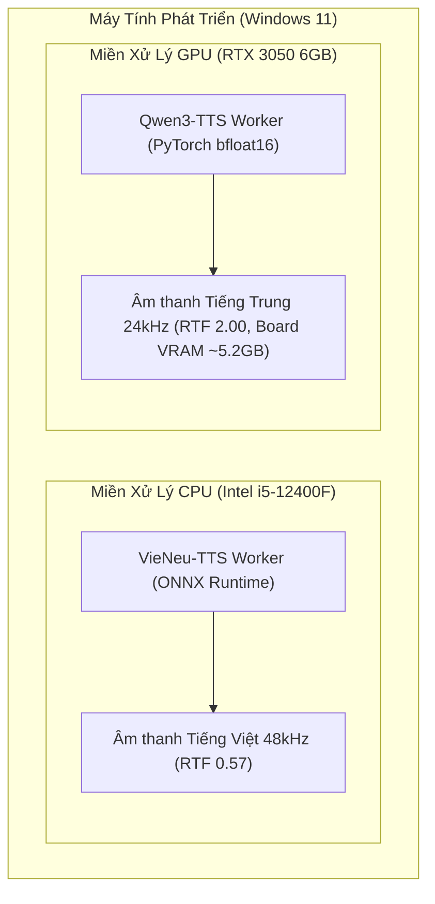

# AI VOICE STUDIO — SO SÁNH HIỆU NĂNG & NĂNG LỰC ĐỘNG CƠ (PHASE 1B COMPARISON)

**Kỹ sư phụ trách:** Lead AI/ML Infrastructure Engineer  
**Ngày thực hiện:** 2026-10-08  
**Phạm vi:** Đối chiếu trực tiếp giữa Engine A (VieNeu-TTS v3 Turbo) và Engine B (Qwen3-TTS 0.6B CustomVoice)  

---

## 1. BẢNG SO SÁNH TỔNG HỢP (HEAD-TO-HEAD MATRIX)

| Tiêu chí so sánh | Engine A: VieNeu-TTS v3 Turbo | Engine B: Qwen3-TTS 0.6B CustomVoice |
|:---|:---|:---|
| **Ngôn ngữ mục tiêu** | **Tiếng Việt (vi)** (Bắc, Trung, Nam) | **Tiếng Trung (zh)** (Mandarin, Dialects) |
| **Phần cứng mục tiêu** | **CPU** (Intel Core i5-12400F) | **GPU** (NVIDIA RTX 3050 6GB VRAM) |
| **Backend suy luận** | ONNX Runtime (Torch-Free) | PyTorch 2.6.0+cu124 (CUDA `sm_86`) |
| **Độ chính xác số học** | `FP32` | `torch.bfloat16` |
| **Dung lượng trọng số** | ~1.1 GB (ONNX + MOSS Codec) | ~2.3 GB (SafeTensors + Tokenizer) |
| **Tần số lấy mẫu (Sample Rate)** | **`48,000 Hz`** (Studio High-Res) | **`24,000 Hz`** (Chuẩn Tokenizer 12Hz) |
| **Thời gian nạp mô hình (Cold Load)** | `59.87s` (Bao gồm fetch weights) | `844.38s` (Tải weights lần đầu ~2.5GB) |
| **Tốc độ sinh (Warm RTF)** | **`0.55 – 0.75`** *(Nhanh hơn thời gian thực)* | **`1.87 – 2.06`** *(Chậm hơn thời gian thực ~2x - Slower-than-real-time)* |
| **Bộ nhớ RAM tiêu thụ** | Đỉnh: **`2,440 MB`** RAM hệ thống | RAM hệ thống: `~1.5 GB` |
| **Bộ nhớ VRAM tiêu thụ** | **`0 MB`** (Không dùng GPU) | PyTorch Allocated: **`2,772 MB`** (Reserved: `3,120 MB`); **Tổng Board VRAM: `~4,680 - 5,250 MB`** / 6,144 MB |
| **Tính năng giọng dựng sẵn** | 25 giọng 3 miền Bắc/Trung/Nam | 9 giọng (Vivian, Uncle_Fu, Serena,...) |
| **Tính năng Voice Cloning** | Code path khả dụng; Chất lượng tương đồng cá nhân: **UNVERIFIED** | Không (CustomVoice là fixed-speaker) |
| **Giấy phép bản quyền** | **Apache-2.0** (Code & Weights) | **Apache-2.0** (Code & Weights) |

---

## 2. PHÂN TÍCH ƯU - NHƯỢC ĐIỂM VÀ ĐÁNH GIÁ ĐỘC LẬP

### 2.1. Đánh giá Engine A (VieNeu-TTS trên CPU)
- **Ưu điểm vượt trội:**
  - **Tốc độ nhanh trên CPU thuần túy:** RTF đạt `0.57` trên Core i5-12400F (sinh 10 giây giọng nói chỉ mất 5.7 giây).
  - **Chất lượng âm thanh 48kHz:** Độ chi tiết và độ trong trẻo cao nhất trong các giải pháp TTS mã nguồn mở hiện nay.
  - **Không cạnh tranh tài nguyên VRAM:** Hoạt động hoàn toàn trên CPU, để lại 100% VRAM GPU cho các tác vụ khác.
  - **Bản quyền mở:** Toàn bộ code và weights đều tuân theo Apache-2.0.
- **Hạn chế kỹ thuật & Lưu ý:**
  - Tải CPU đạt ~68-73% trong lúc sinh âm thanh (cần giới hạn `MAX_CONCURRENT_CPU_JOBS = 1` như thiết kế của Phase 1).
  - Đã xác thực pipeline kỹ thuật tiếp nhận tham chiếu âm thanh, nhưng **chất lượng âm học và độ tương đồng giọng nói cá nhân thực tế vẫn là UNVERIFIED** do thiếu mẫu audio thực tế từ người dùng.
  - 5 lượt chạy liên tiếp cho thấy tính ổn định ngắn hạn, nhưng **chưa chứng minh sự vắng mặt của rò rỉ bộ nhớ dài hạn**.

### 2.2. Đánh giá Engine B (Qwen3-TTS trên GPU)
- **Ưu điểm vượt trội:**
  - **Mức tiêu thụ PyTorch trong giới hạn card 6GB:** Đỉnh PyTorch allocated đạt `2.77 GB` (reserved cache `3.12 GB`).
  - **Phát âm tiếng Trung tự nhiên:** Chất lượng giọng đọc tiếng Trung phổ thông của `Vivian`, `Serena` và giọng nam `Uncle_Fu` có độ truyền cảm cao, phát âm chuẩn ngữ điệu.
  - **Phục hồi lỗi vững vàng:** Xử lý ngoại lệ tham số tức thì, không làm nghẽn tiến trình CUDA.
- **Hạn chế kỹ thuật & Cảnh báo an toàn phần cứng:**
  - **Nguy cơ CUDA OOM CHƯA bị triệt tiêu:** Mặc dù PyTorch chỉ xin cấp phát 2.77 GB, nhưng tổng lượng VRAM thực tế bị chiếm dụng trên bo mạch (đo qua `nvidia-smi`, bao gồm Windows DWM và các ứng dụng đồ họa nền) đã lên tới **`~4,680 - 5,250 MB`** trên tổng số 6,144 MB. Biên an toàn VRAM còn lại thực tế chỉ là **`< 900 - 1,400 MB`**. Nếu người dùng mở thêm trình duyệt xem video, phần mềm đồ họa, hoặc prompt đầu vào có độ dài lớn, nguy cơ tràn bộ nhớ CUDA OOM hoàn toàn có thể xảy ra.
  - **Tốc độ sinh chậm hơn thời gian thực (Slower-than-real-time):** RTF đạt `~2.0` (chưa biên dịch được `flash-attn` trên Windows). Mỗi giây âm thanh cần 2 giây để sinh ra, do đó **hoàn toàn không phù hợp cho tương tác trực tiếp/streaming thời gian thực**, bắt buộc phải xử lý qua hàng đợi phi đồng bộ bền vững (Durable Background Queue).
  - Tần số lấy mẫu là 24,000 Hz (đặc trưng của Qwen3 Tokenizer 12Hz), cần module resampler nếu trộn chung với audio 48kHz của VieNeu.

---

## 3. ĐÁNH GIÁ CHẠY ĐỒNG THỜI (CONCURRENT CPU + GPU EXECUTION) — [UNVERIFIED]

Thiết kế kiến trúc đề xuất chia tải: VieNeu-TTS chạy trên CPU và Qwen3-TTS chạy trên GPU:

> [!WARNING] Trạng thái kiểm chứng: **UNVERIFIED (CHƯA ĐƯỢC KIỂM THỬ ĐỒNG THỜI)**
> 
> Trong Phase 1B, hai engine này chỉ được kiểm thử **riêng rẽ và tuần tự**. Việc chạy đồng thời 100% công suất cả VieNeu trên CPU (chiếm ~73% CPU, ~2.4GB RAM) và Qwen3 trên GPU (chiếm ~5.2GB board VRAM, bus RAM, tải CPU bổ sung) **CHƯA TỪNG ĐƯỢC ĐO LƯỜNG ĐỒNG THỜI**.  
> Nguy cơ tiềm ẩn: nghẽn băng thông bus bộ nhớ hệ thống, quá nhiệt (thermal throttling), sụt giảm xung nhịp, hoặc Windows Desktop Manager sập do cạn kiệt tài nguyên dùng chung.  
> Do đó, kiến trúc Phase 2 phải áp dụng chính sách cấp phát tài nguyên phòng thủ: **chỉ cho phép tối đa 1 tác vụ GPU tại một thời điểm** và quản lý chặt chẽ slot CPU.
