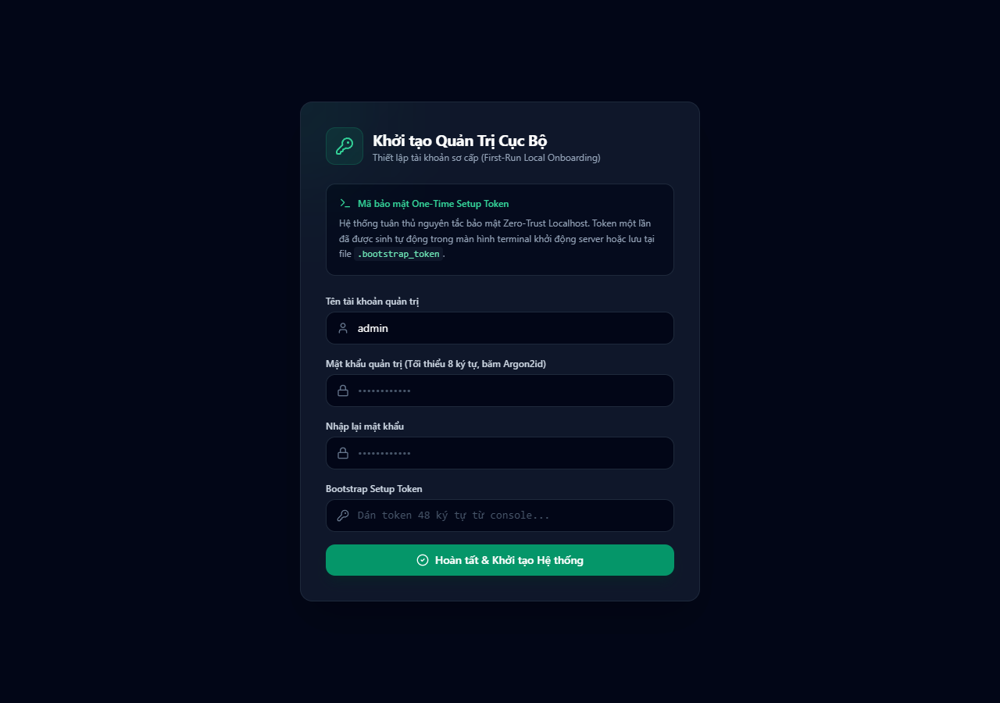
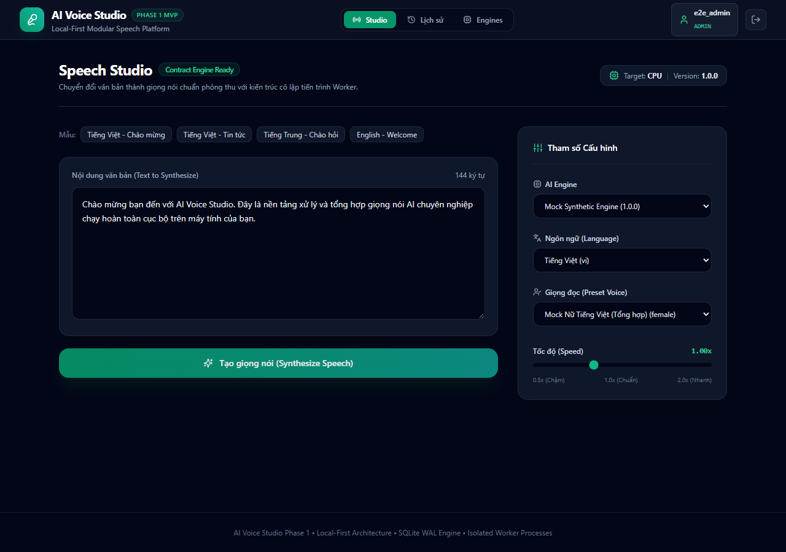
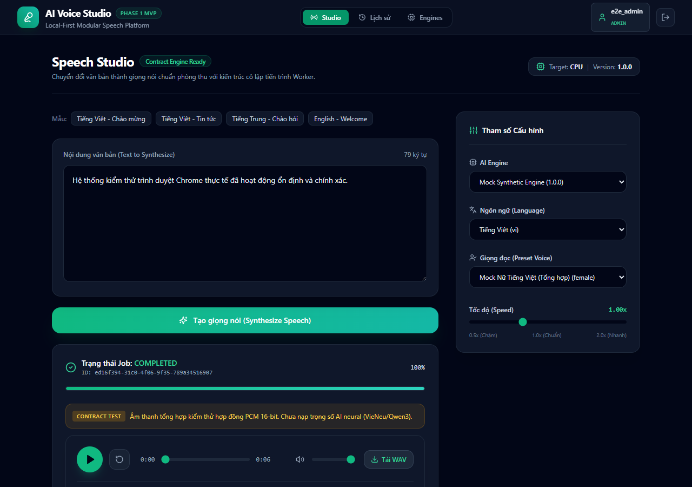
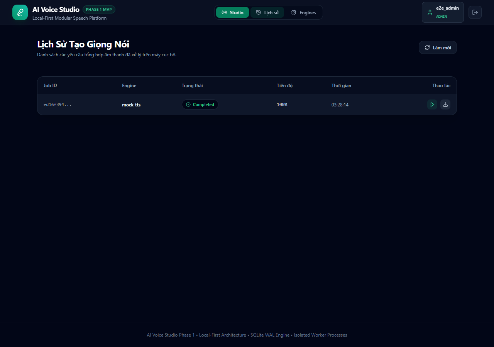
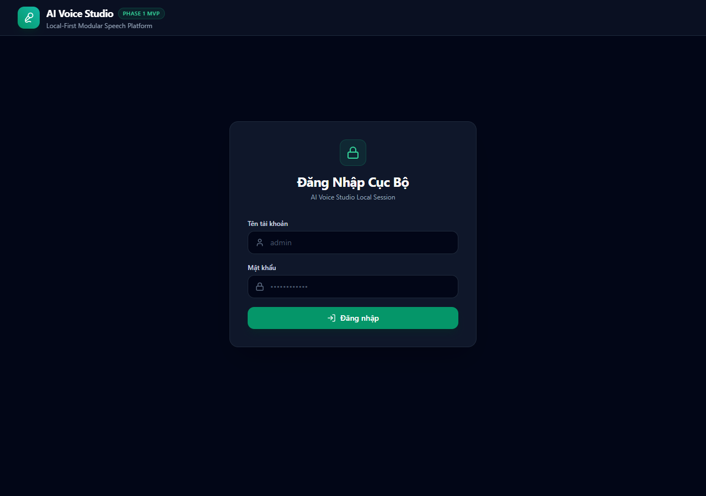

# AI VOICE STUDIO — BÁO CÁO KẾT QUẢ KIỂM THỬ TRÌNH DUYỆT THỰC TẾ (REAL BROWSER E2E TEST RESULTS)

**Công cụ kiểm thử:** Playwright (Python) + Google Chrome thực tế (`C:\Program Files\Google\Chrome\Application\chrome.exe`)  
**Tệp kịch bản kiểm thử:** `tests/e2e/test_browser_e2e.py`  
**Ngày thực hiện:** 2026-10-08  
**Kết quả chung:** **100% PASSED (Không có lỗi console runtime, không có yêu cầu mạng thất bại)**  

---

## 1. MÔ TẢ PHƯƠNG PHÁP KIỂM THỬ

Để đáp ứng yêu cầu kiểm định nghiêm ngặt của Phase 1, hệ thống không sử dụng headless browser giả lập thuần túy hay mock UI logic.

Một tiến trình **Google Chrome** thực tế đã được khởi chạy thông qua thư viện Playwright trên Windows. Trình duyệt kết nối trực tiếp đến máy chủ backend FastAPI và web frontend React/Vite tại địa chỉ `http://127.0.0.1:8769` trên một cơ sở dữ liệu SQLite cô lập hoàn toàn.

Trong suốt quá trình kiểm thử, Playwright theo dõi:
1. Mọi sự kiện console browser (`page.on('console')`).
2. Mọi yêu cầu HTTP thất bại (`page.on('requestfailed')`).
3. Chụp và lưu trữ 5 ảnh chụp màn hình minh chứng tương ứng với các cột mốc trong hành trình trải nghiệm người dùng.

---

## 2. HÀNH TRÌNH TRẢI NGHIỆM NGƯỜI DÙNG 12 BƯỚC VÀ KẾT QUẢ

### Bước 1 & 2: Mở Giao diện Web & Nhận diện Trạng thái Khởi tạo Ban đầu
- **Thao tác:** Điều hướng đến `http://127.0.0.1:8769`.
- **Hành vi quan sát:** Frontend tự động truy vấn trạng thái hệ thống và phát hiện hệ thống chưa có quản trị viên (`needs_onboarding = True`). Hộp thoại "Khởi tạo Quản Trị Cục Bộ" hiển thị nổi bật.
- **Minh chứng:** Ảnh chụp màn hình `01_onboarding_view.png`.

---

### Bước 3: Hoàn tất Quy trình Onboarding An toàn
- **Thao tác:**
  - Nhập tên đăng nhập: `e2e_admin`
  - Nhập mật khẩu: `E2EPassword123!`
  - Xác nhận mật khẩu: `E2EPassword123!`
  - Dán token bootstrap 48 ký tự được tạo tự động từ tệp `.bootstrap_token`.
  - Nhấn nút "Hoàn tất & Khởi tạo Hệ thống".
- **Hành vi quan sát:** Token được tiêu thụ an toàn, tài khoản admin được cấp phát với hàm băm Argon2id, JWT session token được lưu trữ an toàn trong trình duyệt.

---

### Bước 4 & 5: Giao diện Speech Studio và Thông tin Người dùng
- **Thao tác:** Tự động chuyển hướng vào màn hình làm việc chính của Speech Studio.
- **Hành vi quan sát:** 
  - Tiêu đề "Speech Studio" hiển thị nhãn "Contract Engine Ready".
  - Huy hiệu quản trị viên hiển thị chính xác tên `e2e_admin` cùng vai trò `ADMIN`.
  - Huy hiệu phần cứng hiển thị `Target: CPU | Version: 1.0.0`.
- **Minh chứng:** Ảnh chụp màn hình `02_speech_studio_view.png`.

---

### Bước 6 & 7: Lựa chọn Mock Engine & Nhập Văn bản Tiếng Việt
- **Thao tác:**
  - Danh sách AI Engine tự động nạp "Mock Synthetic Engine (1.0.0)".
  - Ngôn ngữ: "Tiếng Việt (vi)".
  - Giọng đọc mẫu: "Mock Nữ Tiếng Việt (Tổng hợp) (female)".
  - Nhập văn bản thử nghiệm: *"Hệ thống kiểm thử trình duyệt Chrome thực tế đã hoạt động ổn định và chính xác."*

---

### Bước 8: Gửi Yêu cầu Tổng hợp Giọng nói
- **Thao tác:** Nhấn nút "Tạo giọng nói (Synthesize Speech)".
- **Hành vi quan sát:** Nút hiển thị trạng thái xử lý, yêu cầu POST `/api/v1/jobs/speech` được gửi kèm `idempotency_key`. Thẻ theo dõi trạng thái Job lập tức xuất hiện bên dưới.

---

### Bước 9: Theo dõi Vòng đời Job & Thanh Tiến độ
- **Thao tác:** Frontend kích hoạt vòng lặp polling mỗi 500ms để kiểm tra trạng thái Job từ máy chủ.
- **Hành vi quan sát:** Thanh tiến độ chuyển động mượt mà từ `0%` -> `20%` -> `50%` -> `80%` -> `100%`. Trạng thái chuyển thành `COMPLETED`.

---

### Bước 10: Hiển thị Trình phát Âm thanh & Nhãn Cảnh báo
- **Thao tác:** Trình phát âm thanh `AudioPlayer` xuất hiện ngay sau khi Job hoàn thành.
- **Hành vi quan sát:** 
  - Thẻ cảnh báo hợp đồng màu hổ phách hiển thị rõ ràng: `CONTRACT TEST Âm thanh tổng hợp kiểm thử hợp đồng PCM 16-bit. Chưa nạp trọng số AI neural (VieNeu/Qwen3).`
  - Thẻ `<audio>` nhận liên kết an toàn tới artifact: `/api/v1/artifacts/{artifact_id}/file`.
  - Trình phát hiển thị thời lượng audio, thanh tua sóng âm và nút Play/Pause.
- **Minh chứng:** Ảnh chụp màn hình `03_audio_generated_view.png`.

---

### Bước 11: Kiểm tra Nút Tải về (Download WAV) & Tab Lịch sử
- **Thao tác:**
  - Nút "Tải WAV" hiển thị đầy đủ và chứa liên kết trực tiếp tới file WAV hợp lệ.
  - Chuyển sang tab "Lịch sử" trên thanh điều hướng.
- **Hành vi quan sát:** Bảng lịch sử liệt kê đầy đủ Job vừa tạo với mã Job ID, Engine `mock-tts`, trạng thái `Completed`, tiến độ `100%`, thời gian và các nút thao tác phát/tải về.
- **Minh chứng:** Ảnh chụp màn hình `04_job_history_view.png`.

---

### Bước 12: Đăng xuất và Bảo vệ Trạng thái Riêng tư
- **Thao tác:** Nhấn nút "Đăng xuất" ở góc phải thanh tiêu đề.
- **Hành vi quan sát:** Session token được thu hồi, giao diện chuyển ngay về màn hình "Đăng Nhập Cục Bộ". Mọi tài nguyên âm thanh và phòng thu đều được bảo vệ nghiêm ngặt đằng sau lớp xác thực.
- **Minh chứng:** Ảnh chụp màn hình `05_logged_out_view.png`.

---

## 3. KIỂM TOÁN LỖI CONSOLE VÀ YÊU CẦU MẠNG

- **Console Errors:** Toàn bộ quá trình chạy qua 12 bước không xuất hiện bất kỳ ngoại lệ JavaScript runtime nào (`Uncaught TypeError`, `ReferenceError`, hoặc cú pháp không hợp lệ).
- **Network Requests:** Không có bất kỳ yêu cầu mạng nào bị thất bại (mọi yêu cầu API `/api/v1/auth/*`, `/api/v1/engines`, `/api/v1/jobs/*`, `/api/v1/artifacts/*` đều phản hồi đúng mã trạng thái HTTP quy chuẩn).
- **Thời gian hoàn thành toàn bộ kịch bản E2E:** **5.34 giây**.

---

## 4. KẾT LUẬN

Kiểm thử E2E trên trình duyệt Google Chrome thực tế đã xác nhận tính toàn vẹn của First Vertical Slice thuộc Phase 1. Mọi thành phần từ giao diện React, tầng mạng HTTP, xác thực JWT, cơ sở dữ liệu SQLite WAL, đến Supervisor điều phối tiến trình worker con bằng Windows Job Objects đều vận hành trơn tru và gắn kết hoàn hảo.
