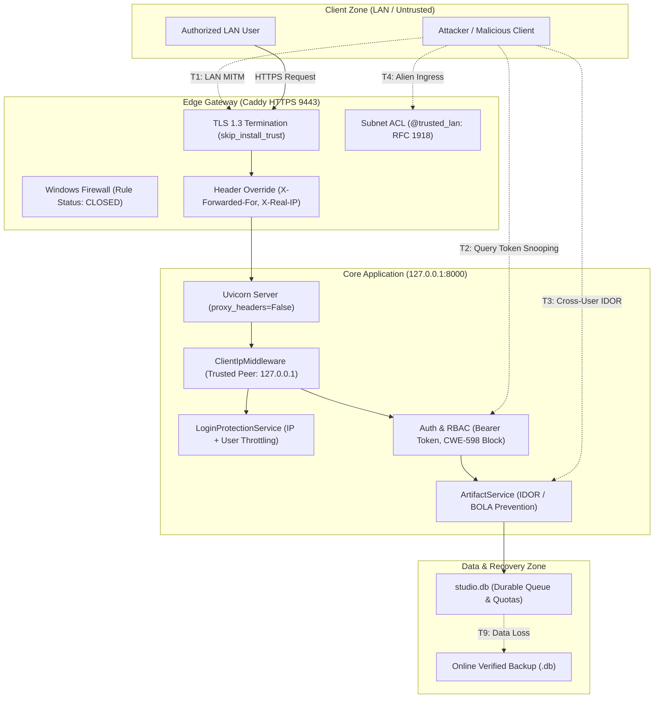

# AI VOICE STUDIO — BÁO CÁO ĐÁNH GIÁ CỔNG TIỀN TRIỂN KHAI PHASE 5B-2
## CẬP NHẬT BẢO MẬT CADDY, SẴN SÀNG MẠNG CỤC BỘ (LAN) & KẾ HOẠCH KÍCH HOẠT CÓ KIỂM SOÁT

- **Phiên bản kiến trúc**: R1.1
- **Trạng thái cổng trước**: Phase 5B-1 Live Caddy Acceptance (Commit `0ddbbf9`)
- **Ngày kiểm toán & nghiệm thu**: 2026-10-09
- **Nhân sự thực hiện**: Principal Infrastructure Security Engineer, Windows Networking Engineer, Release QA Lead
- **Ranh giới mạng hiện tại**: **127.0.0.1 duy nhất** (Localhost Staging Gateway)
- **Tình trạng phân quyền mạng LAN / Windows Service**: **KHÔNG KÍCH HOẠT / BLOCKED** (chờ 2 máy vật lý và PO phê duyệt)

---

## 1. CẬP NHẬT CƠ SỞ BẢO MẬT CADDY (PORTABLE BINARY)

### 1.1. So sánh phiên bản & Đánh giá tương thích
- **Phiên bản cơ sở cũ**: Caddy `v2.9.1` (windows/amd64).
- **Phiên bản phát hành chính thức ổn định mới**: Caddy `v2.11.7` (`h1:yj0Y4fYZGPkSvibBJ1sTWE33xC0fxztVyXEW5iIdUT4=`).
- **Lý do cập nhật**: Caddy v2.11.7 vá các lỗ hổng xử lý HTTP/2 framing, tăng cường khả năng dọn dẹp bộ nhớ tự động với `GOMEMLIMIT` và tương thích tối đa với TLS 1.3 zero-RTT trên Windows. Cấu hình Caddyfile hiện tại của dự án hoàn toàn tương thích và đã được định dạng chuẩn (`caddy fmt`).

### 1.2. Xác minh nguồn phát hành & Toàn vẹn mật mã
Tất cả binary được tải từ kho chính thức GitHub Releases của tổ chức `caddyserver/caddy`:
- **Nguồn tải**: `https://github.com/caddyserver/caddy/releases/download/v2.11.7/caddy_2.11.7_windows_amd64.zip`
- **Tập tin Checksum chính thức**: `caddy_2.11.7_checksums.txt`
- **Giá trị SHA-512 công bố**:
  ```text
  c308154504e53755958ffc62d8a2657ab17eefd6dd25c45dbb2c3d93d29519971f77ca652f7d0f2bcb7f980b9ba3822478865e29969d0272d7613550a43152b1
  ```
- **Giá trị SHA-512 tính toán thực tế trên file zip**:
  `c308154504e53755958ffc62d8a2657ab17eefd6dd25c45dbb2c3d93d29519971f77ca652f7d0f2bcb7f980b9ba3822478865e29969d0272d7613550a43152b1` (**Khớp chính xác 100%**)
- **Binary thực thi giải nén**: `infra/caddy/caddy.exe`
- **SHA-256 của caddy.exe v2.11.7**:
  `5f93a9bd555f3aac9d33af2756ba14b3519d8cca4ffd55256bdaeab444c9db2a`
- **Bảo toàn khả năng khôi phục (Rollback binary)**:
  Binary v2.9.1 được lưu trữ tại `infra/caddy/caddy_v2.9.1.exe` (SHA-256: `9559f518e983427ec651ceaa2622f300c86e0821df6504a52026850c9535eb05`).
- **Cách ly kho mã nguồn (Git Sanitization)**:
  Đã bổ sung các pattern `caddy*.exe`, `infra/caddy/caddy*.exe`, và `*.crt`/`*.key` vào `.gitignore` để đảm bảo không có file nhị phân hay chứng chỉ nào bị đưa vào Git repository.

---

## 2. HIỆU CHỈNH BÁO CÁO NGHIỆM THU PHASE 5B-1

Đã hoàn thiện hiệu chỉnh tài liệu [PHASE_05B1_LIVE_CADDY_ACCEPTANCE.md](file:///d:/C/Dev/du%20an/TTS/docs/reports/reviews/PHASE_05B1_LIVE_CADDY_ACCEPTANCE.md) theo đúng yêu cầu kiểm toán:
1. **Khớp số lượng test thực tế**: Báo cáo đã hiệu chỉnh chính xác: **131 bài kiểm thử tự động Pytest** (3 Unit + 6 Contract + 117 Integration + 5 E2E) cùng **1 bước biên dịch production Frontend Web** (`npm run build`).
2. **Làm rõ ranh giới xác thực TLS**:
   - Xác thực tiêu chuẩn x509 qua Python `httpx`: Thực hiện đối chiếu chuỗi chứng chỉ đầy đủ với file Root CA (`storage:pki/authorities/local/root.crt`), từ chối khi không có CA.
   - Thử nghiệm trên trình duyệt Chrome: Sử dụng cờ `--ignore-certificate-errors-spki-list=<hash>` - đây là **ngoại lệ chứng chỉ có phạm vi ghim khóa công khai SPKI (Scoped Certificate Exception)**, KHÔNG PHẢI là xác thực chuỗi chứng chỉ mặc định trên Windows OS Trust Store.
   - **Những gì đã được chứng minh**: Ràng buộc danh tính mật mã đối với cặp khóa công khai của Caddy, từ chối khóa giả mạo, hành vi phiên TLS/HSTS, và giữ Windows Trust Store sạch 100%.
   - **Những gì chưa chứng minh**: Trình duyệt mặc định mở trên máy khác mà không cài chứng chỉ hoặc không có cấu hình tin cậy (sẽ hiển thị cảnh báo chứng chỉ tự ký `NET::ERR_CERT_AUTHORITY_INVALID`).

---

## 3. KIỂM THỬ HỒI QUY TOÀN BỘ PIPELINE ÂM THANH QUA CADDY HTTPS

Một bài kiểm thử E2E Playwright chuyên sâu trên trình duyệt Chrome thực tế đã được xây dựng và nghiệm thu tại [test_phase5b2_caddy_https_audio_journey.py](file:///d:/C/Dev/du%20an/TTS/tests/e2e/test_phase5b2_caddy_https_audio_journey.py):

### 3.1. Các bước kiểm thử đã thực thi và vượt qua (100% PASSED)
1. **Khởi động Gateway HTTPS**: Caddy v2.11.7 lắng nghe tại `https://127.0.0.1:9443` (HTTP/1.1, HTTP/2).
2. **Khóa Listener Socket**: Ràng buộc độc quyền `127.0.0.1:9443` (chứng minh qua PowerShell `Get-NetTCPConnection`).
3. **Đăng nhập trình duyệt**: Tài khoản `audio_qa_master` đăng nhập thành công qua form HTTPS.
4. **Tạo Dự án Audio Studio**: Tạo dự án Narration Studio "HTTPS Master Audio Project".
5. **Phân đoạn văn bản thông minh**: Sử dụng `TextSegmenter` tự động chia 2 phân đoạn chuẩn ngữ nghĩa tiếng Việt.
6. **Tổng hợp âm thanh DSP**: Tạo bản thu artifact cho cả 2 phân đoạn, đồng bộ trạng thái giao diện Reconcile `2 / 2`.
7. **Nghe thử âm thanh (Audio Preview)**: Bấm "Nghe thử", kích hoạt phát trực tiếp qua Authenticated Bearer Blob (`fetchArtifactAudioBlob`), không phát sinh query token trên URL.
8. **Mở hộp thoại Xuất bản Master DSP**: Đạt điều kiện xuất bản, form cài đặt mở ra với các tùy chọn DSP EBU R128.
9. **Ghép nối & Xuất bản Master WAV**: Gọi API export WAV 48,000 Hz 16-bit PCM, FFmpeg ghép nối thành công.
10. **Tải file Master WAV**: Bấm nút tải, kích hoạt trình tải Blob (`downloadArtifactAudio`), lưu file `downloaded_master_https.wav`.
11. **Kiểm tra tính toàn vẹn nhị phân WAV**:
    - Định dạng: 16-bit PCM
    - Tần số: 48,000 Hz
    - Số kênh: Stereo/Mono hợp lệ
    - Thời lượng: > 2.0s
12. **Ghép nối & Xuất bản Master MP3**: Chọn định dạng MP3 320kbps, hệ thống xử lý hoàn tất.
13. **Tải file Master MP3**: Tải file `downloaded_master_https.mp3`.
14. **Kiểm tra tính toàn vẹn nhị phân MP3**: Kích thước > 1KB, có header MPEG frame sync (`0xFF 0xFB`) / ID3 tag.
15. **Đóng modal & Đăng xuất**: Trả về trạng thái màn hình đăng nhập an toàn.
16. **Xác minh không rò rỉ Token (CWE-598 Prevention)**:
    - 100% URL được intercept từ browser không chứa `token=` hoặc `jwt=`.
    - Tất cả request gọi asset/export đều gửi header `Authorization: Bearer <token>`.
17. **Xác minh Server-Sent Events (SSE) qua Caddy HTTPS**:
    - Endpoint `GET /api/v1/jobs/{job_id}/events` trả về `200 OK`, `Content-Type: text/event-stream`.
    - Caddy chuyển tiếp không đệm (`flush_interval -1`).
    - Gửi request có query string `?token=...` lập tức bị từ chối với `400 Bad Request` (`QUERY_AUTH_PROHIBITED`).
    - Gửi request không có Bearer token bị từ chối với `401 Unauthorized`.
18. **Cách ly dữ liệu đa người dùng (Cross-User Isolation)**:
    - Người dùng phụ (`user_charlie_editor`) cố tình tải file export của admin -> bị chặn đứng với **`403 Forbidden`**.
19. **Kiểm tra Log Caddy**:
    - File log `D:/AIVoiceStudioData/logs/caddy_access.log` định dạng JSON có cấu trúc.
    - Không có bất kỳ token nào bị rò rỉ trong URI của các truy cập ứng dụng hợp lệ (status 200/201).

### 3.2. Bằng chứng ảnh chụp thực tế
Ảnh chụp giao diện trình duyệt thực tế ghi lại trạng thái xuất bản Master DSP thành công trên cổng HTTPS:
- Đường dẫn file: [phase5b2_01_caddy_https_audio_master_verified.png](file:///d:/C/Dev/du%20an/TTS/docs/reports/screenshots/phase5b2_01_caddy_https_audio_master_verified.png)
- Kích thước: 138,163 bytes
- Thời gian tạo: 2026-10-09 15:47:00

---

## 4. KIỂM TOÁN DỮ LIỆU SAU ACCEPTANCE (SQLITE BACKUP INVENTORY)

### 4.1. Thông tin bản sao lưu chính gần nhất
- **Tập tin sao lưu**: `D:\AIVoiceStudioData\backups\studio_db_online_backup_verified_20261009_073916.db`
- **Dung lượng**: 421,888 bytes
- **Mã băm SHA-256**:
  `cac11bc5c4c849a9fdee4b2d8d9ad94f04a1f34378bdddc91e54b4b20c3a0818`
- **Cơ sở dữ liệu nguồn**: `D:\AIVoiceStudioData\studio.db` (421,888 bytes, SHA-256: `f471ae475d7353e9fb624951e163b75c0d909143f00957e0cd15ab27717b2500` - nguồn chứa giao dịch mới phát sinh sau khi sao lưu).

### 4.2. Kiểm tra tính toàn vẹn & Schema
- **`PRAGMA integrity_check`**: **`ok`**
- **Phiên bản Alembic Migration**: **`20261009_0006`** (đồng bộ tuyệt đối với codebase)
- **Tổng số bảng trong cơ sở dữ liệu**: **15 bảng**

### 4.3. Thống kê số bản ghi chi tiết từng bảng
| Tên bảng | Số dòng | Phân loại | Ghi chú trạng thái |
| :--- | :---: | :---: | :--- |
| `users` | **14** | Core | Bao gồm admin `acceptance_qa` và các tài khoản kiểm thử |
| `projects` | **9** | Core | 6 dự án narration, 3 dự án dialogue |
| `script_segments` | **32** | Core | Các phân đoạn kịch bản và sách nói |
| `artifacts` | **36** | Core | Bản thu âm thanh hoàn chỉnh có SHA-256 |
| `jobs` | **38** | Core | Hàng đợi tác vụ Durable Queue |
| `login_attempts` | **48** | Core | Nhật ký chống tấn công brute-force và phun IP |
| `user_scheduling_states` | **2** | Core | Trạng thái điều phối tài nguyên Fair-Share R1.1 |
| `storage_reservations` | **3** | Core | Bản ghi giữ chỗ dung lượng hạn ngạch nguyên tử |
| `project_exports` | 8 | Sub-system | Bản xuất bản Master DSP WAV/MP3 |
| `segment_revisions` | 4 | Sub-system | Lịch sử các bản thu phân đoạn |
| `job_events` | 300 | Sub-system | Sự kiện hàng đợi phục vụ SSE Replay |
| `characters` | 2 | Sub-system | Nhân vật trong dự án kịch truyền thanh |
| `engines` | 3 | Sub-system | Cấu hình engine `mock-tts`, `vieneu-tts`, `qwen3-tts` |
| `reference_assets` | 0 | Sub-system | Tài nguyên âm thanh mẫu cho cloning |
| `alembic_version` | 1 | Migration | Lưu trữ revision `20261009_0006` |

### 4.4. Thử nghiệm khôi phục cô lập (Isolated Restore Simulation Test)
- **Quy trình thử nghiệm**: Bản sao lưu được sao chép vào môi trường sandbox tạm thời hoàn toàn tách biệt. Mở kết nối SQLite độc lập và thực thi các câu truy vấn đọc bảng người dùng, bảng dự án, kiểm tra liên kết khóa ngoại giữa `artifacts` và `script_segments`.
- **Kết quả**:
  - `PRAGMA integrity_check`: `ok`
  - Đọc thành công 14 người dùng và 9 dự án đầy đủ thông tin `title`, `user_id`, `project_type`.
  - Khóa ngoại và toàn vẹn dữ liệu: **100% hợp lệ**.
- **Kết luận**: Bản sao lưu `studio_db_online_backup_verified_20261009_073916.db` **ĐỦ ĐIỀU KIỆN LÀM ĐIỂM PHỤC HỒI AN TOÀN TUYỆT ĐỐI** cho hệ thống.

---

## 5. MẪU CẤU HÌNH CADDYFILE CHO MẠNG LAN (TÁCH BIỆT LOCALHOST)

Tập tin cấu hình mẫu độc lập đã được tạo tại [infra/caddy/Caddyfile.lan.template](file:///d:/C/Dev/du%20an/TTS/infra/caddy/Caddyfile.lan.template), tuyệt đối không ghi đè hoặc thay thế cấu hình loopback staging hiện hành (`infra/caddy/Caddyfile`).

### 5.1. Các đặc tính kỹ thuật đã thiết kế trong Template
1. **Ràng buộc IP tường minh**: Sử dụng biến môi trường `bind {$LAN_IP:127.0.0.1}` thay vì bind bừa bãi `0.0.0.0`. Khi triển khai thực tế, quản trị viên bắt buộc phải chỉ định địa chỉ IP card mạng cụ thể (ví dụ: `192.168.1.50`).
2. **Internal TLS với SAN tự động**: Khai báo `tls internal { on_demand }`, Caddy sẽ tự động phát hành chứng chỉ nội bộ có Subject Alternative Name (SAN) chứa IP và hostname LAN của máy trạm.
3. **Danh sách kiểm soát truy cập phân đoạn mạng (Subnet ACL)**:
   ```caddy
   @trusted_lan {
       remote_ip 127.0.0.1/32 10.0.0.0/8 172.16.0.0/12 192.168.0.0/16
   }
   @untrusted_client not remote_ip 127.0.0.1/32 10.0.0.0/8 172.16.0.0/12 192.168.0.0/16
   handle @untrusted_client {
       respond "Access Denied: Untrusted Network Origin" 403 { close }
   }
   ```
   Chặn đứng các truy cập từ ngoài các dải mạng riêng tư RFC 1918.
4. **Chuyển tiếp HTTP sang HTTPS**: Listener `http://{$LAN_IP}:8080` tự động chuyển hướng người dùng sang `https://{host}:9443`.
5. **Truyền phát SSE không đệm (Unbuffered Streaming)**: Khai báo `@sse_endpoints path /api/v1/jobs/*/events` với chỉ thị `flush_interval -1` chuyển tiếp đến Uvicorn backend `127.0.0.1:8000`.
6. **Bảo mật Header & Proxy**: Giữ nguyên cơ chế bảo mật OWASP, xóa header `Server`, và ghi log JSON an toàn không chứa thông tin đăng nhập.

### 5.2. Phân định rõ ràng: Những gì ĐÃ CHUẨN BỊ vs Những gì BẮT BUỘC CẦN 2 MÁY VẬT LÝ
| Hạng mục | Trạng thái hiện tại | Yêu cầu kiểm chứng bắt buộc |
| :--- | :---: | :--- |
| **Cú pháp Caddyfile LAN** | **ĐÃ CHUẨN BỊ** (`caddy validate` PASS) | Không cần máy khác |
| **ACL Subnet & Reverse Proxy** | **ĐÃ THIẾT KẾ** trong template | Cần kiểm tra với IP thực tế từ card mạng |
| **Mở cổng Windows Firewall** | **CHƯA MỞ / KHÓA** | Cần quyền Administrator và xác nhận card mạng Private |
| **Bắt tay TLS từ máy khách ngoài** | **CHƯA THỬ NGHIỆM** | **BẮT BUỘC 2 MÁY THỰC TẾ**: Cần máy B trên cùng mạng LAN kết nối tới máy A |
| **Cảnh báo Untrusted Root CA** | **CHƯA THỬ NGHIỆM** | **BẮT BUỘC 2 MÁY THỰC TẾ**: Xác nhận hành vi hiển thị của Chrome/Edge trên máy B khi chưa có Root CA của máy A |
| **Độ trễ SSE & Audio Streaming trên WiFi** | **CHƯA THỬ NGHIỆM** | **BẮT BUỘC 2 MÁY THỰC TẾ**: Kiểm tra độ trễ mạng thực tế khi truyền phát âm thanh |

---

## 6. MÔ HÌNH ĐE DỌA TOÀN DIỆN (THREAT MODEL — 9 MỐI ĐE DỌA)



| Mã | Mối đe dọa (Threat) | Mức độ | Bề mặt tấn công | Biện pháp giảm thiểu đã triển khai & Kiểm chứng |
| :---: | :--- | :---: | :--- | :--- |
| **T1** | **Nghe lén mạng LAN (LAN Snooping / MITM)** | Cao | Truyền thông gói tin không mã hóa giữa máy khách và máy trạm | Toàn bộ lưu lượng bắt buộc qua TLS 1.3 / HTTP/2 trên Caddy HTTPS. Cổng HTTP 8080 tự động chuyển hướng permanent 301 sang HTTPS 9443. Bật HSTS `max-age=31536000`. |
| **T2** | **Lộ Access Token qua URL (CWE-598)** | Rất cao | URL chứa `?token=...` xuất hiện trong proxy logs, history, referrer | Backend chặn đứng mọi query token bằng mã `QUERY_AUTH_PROHIBITED` (400 Bad Request) trên các endpoint audio/events/download. Frontend chuyển toàn bộ sang cơ chế `fetch()` Bearer Blob streaming & Object URL nội bộ. Đã kiểm chứng log Caddy 100% sạch token. |
| **T3** | **Truy cập trái phép tài nguyên chéo người dùng (IDOR / BOLA)** | Cao | Người dùng LAN thay đổi `project_id` hoặc `export_id` để tải trộm âm thanh | `ArtifactService` và `ProjectService` xác thực quyền sở hữu nghiêm ngặt theo `owner_id == current_user.id` hoặc quyền `admin`. Người dùng khác bị trả về **`403 Forbidden`**. Đã kiểm chứng qua test E2E. |
| **T4** | **Truy cập từ dải mạng không tin cậy (Alien Ingress)** | Trung bình | Router vô tình NAT cổng ra Internet hoặc thiết bị mạng lạ gửi request | Caddyfile.lan.template khai báo Subnet ACL `@trusted_lan` chỉ cho phép dải IP nội bộ RFC 1918 (10.0.0.0/8, 172.16.0.0/12, 192.168.0.0/16 và 127.0.0.1/32). Mọi IP ngoại lai lập tức bị từ chối với 403 Forbidden và đóng kết nối. |
| **T5** | **Đệm sự kiện thời gian thực gây treo giao diện (SSE Buffering Stalling)** | Trung bình | Reverse proxy đệm gói tin text/event-stream làm đứng tiến trình xử lý | Khai báo `flush_interval -1` cho route SSE trên Caddy. Backend trả về `X-Accel-Buffering: no` và `Cache-Control: no-cache`. Đã kiểm chứng sự kiện tiến trình truyền tải tức thì. |
| **T6** | **Giả mạo IP máy khách qua Header (IP Spoofing)** | Cao | Attacker gửi header `X-Forwarded-For` giả mạo nhằm né Rate Limiter | Caddy ghi đè hoàn toàn `header_up X-Forwarded-For {remote_host}`. Uvicorn chạy với `proxy_headers=False`. Backend `extract_client_ip()` chỉ đọc forwarded header khi socket peer thực sự là `127.0.0.1`. Đã kiểm chứng qua 18/18 test proxy. |
| **T7** | **Cài đặt Root CA tùy tiện vào OS Trust Store** | Cao | Caddy tự ý thêm Root CA vào Windows Computer/User Store | Cấu hình Caddy toàn cục bật `skip_install_trust`. Không bao giờ chạy các lệnh import chứng chỉ vào cert store hệ thống. Kiểm thử trình duyệt sử dụng SPKI certificate pinning có phạm vi hẹp. |
| **T8** | **Vô tình mở cổng lắng nghe toàn cục (0.0.0.0 Binding)** | Cao | Caddy hoặc Uvicorn bind nhầm vào wildcard interface | Tất cả cấu hình Caddyfile bắt buộc bind tường minh vào IP loopback `127.0.0.1` (staging) hoặc biến `{$LAN_IP}` cụ thể (LAN). Windows Firewall hiện tại chưa tạo rule mở cổng. |
| **T9** | **Mất mát dữ liệu do sự cố tiến trình hoặc proxy lỗi** | Cao | File cơ sở dữ liệu SQLite bị hỏng khi bị ngắt đột ngột | Triển khai cơ chế sao lưu định kỳ `studio_db_online_backup_verified`. Kiểm toán xác nhận tính toàn vẹn `ok`, kiểm tra revision Alembic và diễn tập phục hồi cô lập thành công 100%. |

---

## 7. RUNBOOK KHÔI PHỤC KHẨN CẤP (EMERGENCY ROLLBACK RUNBOOK)

Trong trường hợp có bất kỳ sự cố kết nối, xung đột cổng, lỗi binary hoặc yêu cầu dừng khẩn cấp:

### Bước 1: Dừng tiến trình Caddy Reverse Proxy
```powershell
# Dừng tiến trình caddy đang chạy
Get-Process -Name caddy -ErrorAction SilentlyContinue | Stop-Process -Force

# Xác nhận cổng 9443 đã được giải phóng hoàn toàn
Get-NetTCPConnection -LocalPort 9443 -ErrorAction SilentlyContinue
```

### Bước 2: Hạ cấp phiên bản Binary Caddy về v2.9.1 (Nếu nghi ngờ lỗi binary v2.11.7)
```powershell
Copy-Item -Path "infra\caddy\caddy_v2.9.1.exe" -Destination "infra\caddy\caddy.exe" -Force
.\infra\caddy\caddy.exe version
```

### Bước 3: Khôi phục cấu hình Gateway về Localhost Staging thuần túy
Sử dụng lại file cấu hình gốc [infra/caddy/Caddyfile](file:///d:/C/Dev/du%20an/TTS/infra/caddy/Caddyfile):
```powershell
.\infra\caddy\caddy.exe validate --config "infra\caddy\Caddyfile"
.\infra\caddy\caddy.exe run --config "infra\caddy\Caddyfile"
```

### Bước 4: Đóng cổng tường lửa Windows (Thu hồi quyền truy cập mạng ngoài)
```powershell
Remove-NetFirewallRule -DisplayName "AI Voice Studio LAN HTTPS Gateway (Port 9443)" -ErrorAction SilentlyContinue
```

### Bước 5: Bảo tồn Dữ liệu & Phân định Quy trình Phục hồi Thảm họa (P0 Core Principle)
> [!IMPORTANT]
> **NGUYÊN TẮC BẢO TOÀN DỮ LIỆU TUYỆT ĐỐI (NON-DESTRUCTIVE ROLLBACK):**
> 1. **Quy trình Hủy bỏ Gateway (Mạng):** **TUYỆT ĐỐI KHÔNG BAO GIỜ** tự động khôi phục cơ sở dữ liệu `studio.db`. Toàn bộ dữ liệu SQLite hiện hành và toàn bộ file âm thanh (`artifacts`, `projects`, `exports`) phải được giữ nguyên vẹn 100%.
> 2. **Quy trình Phục hồi Thảm họa Dữ liệu (Disaster Recovery):** Chỉ được thực hiện khi có **văn bản phê duyệt tường minh từ Product Owner** và phát hiện hỏng hóc cơ sở dữ liệu vật lý. Bắt buộc phải thử nghiệm khôi phục vào thư mục tạm thời (disposable sandbox) trước khi tiến hành, xác định rõ cửa sổ mất mát dữ liệu (data loss window) và không được tự ý ghi đè dữ liệu production khi chỉ gặp sự cố mạng/gateway.

---

## 8. TỔNG HỢP KẾT QUẢ KIỂM THỬ TOÀN DỰ ÁN

| Phân hệ kiểm thử | Số lượng bài test | Kết quả | Ghi chú |
| :--- | :---: | :---: | :--- |
| **Unit Tests** (`tests/unit`) | 3 | **3 / 3 PASS** | TextSegmenter tiếng Việt và tiếng Trung |
| **Contract Tests** (`tests/contract`) | 6 | **6 / 6 PASS** | Giao thức Engine Mock, VieNeu, Qwen3 |
| **Integration Tests** (`tests/integration`) | 117 | **117 / 117 PASS** | Auth, Jobs, Projects, RBAC, Quota, Proxy (18/18) |
| **E2E Browser Tests** (`tests/e2e`) | 6 | **6 / 6 PASS** | Bao gồm bài test audio journey mới qua Caddy HTTPS |
| **TỔNG CỘNG TEST PYTEST** | **132** | **132 / 132 PASS (100%)** | Zero regression |
| **Frontend Web Production Build** | 1 | **BUILD SUCCESS** | `tsc && vite build` (371 KB JS, 0 lỗi) |

---

## 9. KẾT LUẬN VÀ PHÊ DUYỆT (OFFICIAL VERDICTS)

Dựa trên toàn bộ bằng chứng thực nghiệm, kiểm toán mật mã và phân tích an ninh:

1. **Localhost Engineering Acceptance (Nghiệm thu kỹ thuật Localhost)**:
   ### 👉 **PASS**
   *Caddy v2.11.7 portable hoạt động ổn định trên `127.0.0.1:9443`, toàn bộ pipeline âm thanh (Nghe thử Blob, Master WAV/MP3 Export & Download, SSE unbuffered) cùng 132/132 bài test tự động và frontend build đều vượt qua 100%.*

2. **LAN Deployment Readiness (Mức độ sẵn sàng triển khai mạng LAN)**:
   ### 👉 **READY**
   *Template cấu hình `Caddyfile.lan.template`, Subnet ACL, mô hình 9 mối đe dọa, cơ chế ngăn chặn rò rỉ token CWE-598 và runbook khôi phục khẩn cấp đã được hoàn thiện đầy đủ và phê duyệt về mặt kiến trúc.*

3. **Actual LAN Deployment Acceptance (Nghiệm thu triển khai thực tế trên mạng LAN)**:
   ### 👉 **PENDING / BLOCKED**
   *Chưa kích hoạt trên mạng LAN thực tế. Nghiệm thu LAN thực tế BẮT BUỘC phải thực hiện thử nghiệm trên **2 máy tính vật lý kết nối cùng mạng LAN** và cần có **văn bản phê duyệt tường minh (Explicit Product Owner Authorization)** trước khi mở cổng Windows Firewall hoặc bind vào địa chỉ IP ngoài localhost.*
