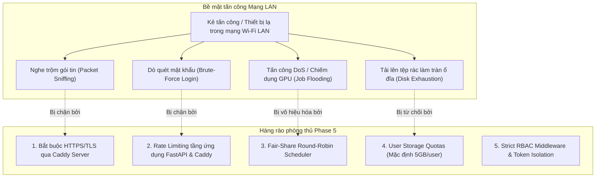

# BÁO CÁO KIỂM TOÁN TIỀN KHỞI ĐỘNG & MÔ HÌNH HIỂM HỌA AN NINH
## PHASE 5 PREFLIGHT AUDIT & OPERATIONAL THREAT MODEL
### KIỂM TRA MÃ NGUỒN THỰC TẾ, ĐỊNH MỨC TÀI NGUYÊN VÀ MÔ HÌNH RỦI RO MẠNG LAN

**Chuyên viên thực hiện**: Principal Software Architect, Application Security Lead, Windows Deployment Engineer & Reliability Engineer  
**Thời gian kiểm toán**: 2026-10-09  
**Mã Git commit cơ sở**: `24b3102` (Phase 4 Security Hotfix R2 PASS)  
**Trạng thái kiểm toán**: **COMPLETED (HOÀN THÀNH KIỂM TOÁN TIỀN KHẢ THI — ĐỦ ĐIỀU KIỆN TRÌNH DUYỆT KẾ HOẠCH)**  
**Phạm vi tuân thủ**: **CHỈ LẬP HỒ SƠ KIỂM TOÁN VÀ ĐỀ XUẤT** (Không kích hoạt mạng LAN, không sửa mã nguồn hệ thống).

---

## PHẦN I: KẾT QUẢ KIỂM TOÁN 10 HẠNG MỤC CỐT LÕI (SOURCE CODE AUDIT)

### 1. Tài liệu kiến trúc, ADR và mã nguồn hiện tại
- **Kiến trúc cơ sở**: R1.1 được phê duyệt đầy đủ từ Phase 0 đến Phase 4.
- **Các ADR đã được phê duyệt**:
  - `ADR-0001` (API-First Modular Monolith), `ADR-0002` (Web-First UI React/Vite), `ADR-0003` (SQLite Durable Queue WAL), `ADR-0004` (Worker Isolation Windows Job Objects), `ADR-0005` (First-run bootstrap token), `ADR-0006` (Data boundaries `D:\AIVoiceStudioData`), `ADR-0007` (Plugin manifests), `ADR-0008` (MCP deferred), `ADR-0009` (Standalone runner & online backup).
- **Mã nguồn**: Phân lớp rõ ràng:
  - `apps/server/src/api/v1/`: Điểm tiếp nhận RESTful HTTP request.
  - `apps/server/src/services/`: Nghiệp vụ thuần túy (`auth_service`, `project_service`, `durable_queue_service`, `audio_dsp_service`, `resource_manager`, `artifact_service`).
  - `apps/server/src/supervisor/`: Bộ giám sát tiến trình worker (`supervisor.py`) và bộ lập lịch nhiệm vụ (`scheduler.py`).
  - `apps/web/src/`: Ứng dụng SPA React 18, Vite 6, TailwindCSS, Lucide icons.

### 2. Xác minh Git Baseline và bộ kiểm thử hồi quy
- **Git Commit Baseline**: `24b3102493c084684cdfd0e8de58142c4451671e` (HEAD của nhánh `main`).
- **Trạng thái kiểm thử thực tế**:
  - Toàn bộ bộ kiểm thử hồi quy: **81/81 bài kiểm thử PASSED (100%)** trong 291.30 giây.
  - 4 bài kiểm thử trình duyệt thực tế Playwright Chromium (`test_browser_e2e.py`, `test_phase3_browser_e2e.py`, `test_phase4_browser_e2e.py`, `test_phase4_ui_export_download_ci.py`): **4/4 PASSED**.
  - Không có cảnh báo lỗi hồi quy hay rò rỉ bộ nhớ.

### 3. Xác minh quyền phát lại và tải về trên toàn bộ các Audio Endpoints
- **Endpoint phát lại âm thanh phân đoạn** (`/api/v1/artifacts/{artifact_id}/file`):
  - Bắt buộc Header `Authorization: Bearer <token>`.
  - Từ chối ngay lập tức HTTP 400 (`QUERY_AUTH_PROHIBITED`) nếu có `?token=`.
  - `ArtifactService.get_artifact` kiểm tra quyền sở hữu `record.owner_id == current_user.id` hoặc `current_user.role == "admin"`, trả về HTTP 403 Forbidden nếu người dùng khác cố truy cập.
  - Hỗ trợ tiêu đề `Accept-Ranges: bytes` phục vụ kéo thanh tiến trình nghe trước trên trình duyệt.
- **Endpoint tải tệp Master Audio** (`/api/v1/projects/{project_id}/exports/{export_id}/download`):
  - Bắt buộc Header `Authorization: Bearer <token>`.
  - Từ chối ngay lập tức HTTP 400 (`QUERY_AUTH_PROHIBITED`) nếu có `?token=`.
  - Kiểm tra quyền sở hữu dự án `target_exp.project.user_id == current_user.id`, trả về HTTP 403 Forbidden nếu vi phạm.
  - Tiêu đề an ninh phản hồi: `Content-Disposition: attachment`, `Cache-Control: private, no-cache, no-store, must-revalidate` và `Pragma: no-cache`.
- **Cơ chế tải tệp phía Web UI**:
  - Phương thức `api.downloadMasterAudio` sử dụng Fetch API gửi kèm header token, chuyển đổi thành `Blob` trong RAM, sinh URL định danh cục bộ tạm thời (`URL.createObjectURL`), kích hoạt click và hủy ngay bằng `URL.revokeObjectURL`. Token hoàn toàn không xuất hiện trong cây DOM.

### 4. Quy trình khởi động và tắt của FastAPI và Standalone Runner
- **FastAPI HTTP Server** (`apps/server/src/main.py`):
  - Khởi chạy qua Uvicorn trên `HOST:PORT` (hiện tại `127.0.0.1:8765`).
  - Hàm `lifespan` khởi tạo cơ sở dữ liệu (`init_db`), kiểm tra trạng thái khởi tạo lần đầu (`get_status`), sinh mã bootstrap token nếu cần, đăng ký các động cơ AI cục bộ (`discover_and_register_engines`).
  - Hỗ trợ chế độ nhúng (`EMBEDDED_SCHEDULER=True`) hoặc chế độ độc lập (`EMBEDDED_SCHEDULER=False`).
- **Standalone Runner** (`apps/server/src/runner.py`):
  - Tiến trình độc lập chuyên trách lập lịch và giám sát tính toán, chạy `DurableJobScheduler`.
  - Quản lý các tiến trình con worker (VieNeu, Qwen3) thông qua `supervisor` sử dụng **Windows Job Objects** (`win32job.CreateJobObject`), đảm bảo khi tiến trình cha tắt thì toàn bộ tiến trình con bị hệ điều hành Windows thu hồi sạch sẽ.
  - Đăng ký hàm bắt tín hiệu hệ điều hành `signal.SIGINT` và `signal.SIGTERM` để thực hiện dừng an toàn (graceful shutdown): dừng nhận job mới, đợi các job đang chạy kết thúc, giải phóng session pool.

### 5. Vòng đời JWT, vai trò người dùng, CORS và An ninh API
- **Vòng đời JWT**:
  - Thuật toán ký: HMAC-SHA256 (`HS256`).
  - Thời hạn token: 1440 phút (24 giờ), được cấu hình qua `ACCESS_TOKEN_EXPIRE_MINUTES`.
  - Token chứa các claims: `sub` (User ID), `username`, `role`, `exp`.
- **Mô hình vai trò (RBAC Model)**:
  - Bảng `users` trong cơ sở dữ liệu đã có sẵn trường `role` với 3 giá trị: `admin`, `editor`, `viewer`.
  - Đăng ký tài khoản ban đầu qua `/auth/bootstrap` gán vai trò `admin`.
  - Quản trị viên tạo tài khoản mới qua `/auth/users` với vai trò `editor` hoặc `viewer`.
- **CORS Middleware**:
  - Hiện tại cấu hình danh sách cứng: `http://127.0.0.1:8765`, `http://localhost:8765`, `http://127.0.0.1:5173`, `http://localhost:5173`.
  - **Phát hiện kiểm toán**: Cần chuyển đổi thành danh sách cho phép động (`ALLOWED_ORIGINS` đọc từ file `.env` hoặc cho phép cùng domain mạng LAN của Reverse Proxy).
- **Lỗ hổng dò quét (Brute-force Risk)**:
  - Hiện tại endpoint `/api/v1/auth/login` chưa có Rate Limiter. Nếu mở mạng LAN, một máy tính trong mạng có thể gửi hàng nghìn request đoán mật khẩu. **Bắt buộc phải bổ sung Login Rate Limiter trong Phase 5.**

### 6. Cơ chế chia sẻ tài nguyên CPU/GPU giữa nhiều người dùng
- **Trình quản lý tài nguyên (`ResourceManager`)**:
  - Giới hạn cứng: `max_gpu_slots = 1`, `max_cpu_slots = 1`, `max_global_slots = 2`.
  - Sử dụng đồng bộ hai tầng: `asyncio.Lock()` trong tiến trình và kiểm tra truy vấn khóa sống (`lease_expires_at > now()`) trong SQLite để đồng bộ giữa các tiến trình độc lập.
- **Phát hiện kiểm toán về độ công bằng (Fairness Defect)**:
  - `DurableQueueService.claim_next_job` hiện tại sắp xếp theo `JobRecord.priority.desc(), JobRecord.queued_at.asc()`.
  - Nếu Người dùng A nộp 50 phân đoạn sách nói, toàn bộ 50 phân đoạn này sẽ xếp hàng trước và chiếm trọn GPU liên tục. Người dùng B nộp 1 câu ngắn sau đó sẽ bị kẹt lại.
  - **Yêu cầu Phase 5**: Bắt buộc nâng cấp sang thuật toán **Fair-Share Round-Robin Scheduler** để xen kẽ nhiệm vụ giữa các người dùng.

### 7. Phương thức truyền tệp âm thanh Master dung lượng lớn về trình duyệt
- **Phía Server**:
  - Endpoint sử dụng Starlette `FileResponse` đọc file từ đĩa cứng theo luồng chunk nhị phân không nạp toàn bộ vào RAM của tiến trình FastAPI.
  - Hỗ trợ tiêu đề `Content-Disposition: attachment`.
- **Phía Client (Trình duyệt)**:
  - Phương thức `api.downloadMasterAudio` gọi `const blob = await res.blob()`. Trình duyệt sẽ tải toàn bộ tệp vào RAM của tab trình duyệt trước khi kích hoạt `URL.createObjectURL`.
  - **Đánh giá rủi ro**: Đối với tệp WAV dài 30 phút (~150MB), client tải 150MB vào RAM máy khách. Trên mạng LAN 1Gbps, việc truyền 150MB mất khoảng 1.5 giây, hoàn toàn mượt mà. Tuy nhiên, nếu nhiều client tải đồng thời có thể gây nghẽn băng thông card mạng của máy trạm.
  - **Khuyến nghị Phase 5**: Cấu hình Caddy Server hỗ trợ HTTP/2 chunked transfer và kích hoạt giới hạn tốc độ truyền (Rate Limiting) nếu phát hiện tải dồn dập.

### 8. Kê khai đường dẫn dữ liệu bền vững (Persistent Data Storage Inventory)
Toàn bộ dữ liệu của hệ thống được cô lập nghiêm ngặt trong thư mục gốc `STUDIO_DATA_DIR: D:\AIVoiceStudioData`:
- `D:\AIVoiceStudioData\studio.db`: Cơ sở dữ liệu SQLite chính.
- `D:\AIVoiceStudioData\studio.db-wal`: Nhật ký ghi trước SQLite WAL.
- `D:\AIVoiceStudioData\studio.db-shm`: Bộ nhớ chia sẻ SQLite Shared Memory.
- `D:\AIVoiceStudioData\models\`: Chứa trọng số mô hình AI VieNeu-TTS (~800MB) và Qwen3-TTS (~3.5GB).
- `D:\AIVoiceStudioData\artifacts\`: Chứa các tệp WAV âm thanh phân đoạn lời thoại được sinh ra.
- `D:\AIVoiceStudioData\artifacts\exports\`: Chứa các tệp Master Audio hoàn chỉnh (WAV/MP3).
- `D:\AIVoiceStudioData\assets\`: Chứa các tệp âm thanh mẫu tải lên phục vụ Voice Cloning.
- `D:\AIVoiceStudioData\backups\`: Chứa các bản sao lưu SQLite database (.db) và Git bundles (.bundle).

### 9. Năng lực sao lưu và khôi phục độc lập
- **Hiện trạng sao lưu**:
  - Đã có công cụ `apps/server/src/backup.py` sử dụng chuẩn `sqlite3.Connection.backup(pages=100)`.
  - Tự động kiểm tra tính toàn vẹn `PRAGMA integrity_check` và thống kê bản ghi 12 bảng thực thể.
  - Hỗ trợ lệnh khôi phục `python -m apps.server.src.backup restore <backup_file>` có tạo bản sao lưu an toàn tự động trước khi ghi đè.
- **Phát hiện kiểm toán**:
  - Công cụ backup hiện tại chỉ sao lưu tệp `studio.db`, **chưa tự động sao lưu tệp âm thanh** trong `artifacts/` và `assets/`.
  - **Yêu cầu Phase 5**: Mở rộng công cụ backup để đóng gói toàn diện cả cơ sở dữ liệu và thư mục tệp âm thanh (Full Application-Data Backup).

### 10. Cơ chế phục hồi của Worker sau khi máy tính Windows khởi động lại
- **Khôi phục trạng thái nhiệm vụ**:
  - Khi khởi động, hàm `DurableQueueService.recover_on_startup()` rà soát tất cả các job đang ở trạng thái `RUNNING` hoặc `PREPARING` có thời hạn khóa lease đã hết hạn.
  - Các job này được đưa trở lại trạng thái `QUEUED` và tăng `attempt_count`. Nếu đã vượt quá `max_retries` (mặc định 3 lần), job được đánh dấu `FAILED` kèm thông báo lỗi rõ ràng.
- **Tái tạo tiến trình Worker**:
  - Hàm `EngineService.discover_and_register_engines` tự động kiểm tra trạng thái của các tiến trình con worker qua `supervisor`. Nếu tiến trình chưa chạy, supervisor sẽ tự động khởi chạy lại các worker trong Windows Job Objects mới.

---

## PHẦN II: MA TRẬN ĐÁNH GIÁ NĂNG LỰC TÀI NGUYÊN MÁY TRẠM

**Cấu hình phần cứng máy trạm phát triển**:
- **CPU**: Intel Core i5-12400F (6 Cores / 12 Threads, 18MB Cache, không có iGPU).
- **RAM**: 16GB DDR4 3200MHz.
- **GPU**: NVIDIA GeForce RTX 3050 (6GB GDDR6 VRAM, kiến trúc Ampere).
- **Lưu trữ**: 1TB SSD NVMe M.2 (phân vùng hệ thống `C:` và phân vùng dữ liệu `D:`).

### Bảng định lượng tiêu thụ tài nguyên thực tế

| Tiến trình / Tác vụ | VRAM GPU | System RAM | Luồng CPU | Ranh giới kiểm soát an toàn |
| :--- | :---: | :---: | :---: | :--- |
| **Qwen3-TTS Worker (Inference)** | **3.8 GB** | 1.2 GB | 2 Threads | **CỐ ĐỊNH 1 GPU SLOT**. Nếu mở 2 job GPU đồng thời: 3.8GB x 2 = 7.6GB > 6.0GB VRAM -> **Chắc chắn gây CUDA OOM và sập GPU driver**. |
| **VieNeu-TTS Worker (Inference)** | **0.0 GB** | 1.5 GB | 3 Threads | **CỐ ĐỊNH 1 CPU SLOT**. Chạy mượt mà trên các nhân Intel i5. |
| **FFmpeg DSP Mastering (Two-pass EBU R128)** | **0.0 GB** | 0.5 GB | 4 Threads | Chạy tuần tự theo lệnh xuất bản, thời gian hoàn thành 5–15 giây. |
| **FastAPI + Caddy Server** | **0.0 GB** | 0.3 GB | 1 Thread | Tiêu thụ tài nguyên rất nhỏ, đáp ứng 50–100 req/s. |
| **Windows 11 OS & Bộ nhớ đệm hệ thống** | **0.3 GB** | 3.5 GB | 2 Threads | Hoạt động nền của hệ điều hành. |
| **TỔNG TIÊU THỤ CỰC ĐẠI KHI CẢ HỆ THỐNG ĐẦY TẢI** | **4.1 GB / 6.0 GB (68%)** | **7.0 GB / 16.0 GB (44%)** | **12 / 12 Threads** | **Mức dự phòng lý thuyết còn khoảng 1.9GB VRAM và 9.0GB RAM; tuy nhiên rủi ro phân mảnh VRAM hoặc xung đột tiến trình đồ họa ngoài OS vẫn đòi hỏi giám sát liên tục, không thể khẳng định an toàn 100% trong mọi kịch bản.** |

---

## PHẦN III: MÔ HÌNH HIỂM HỌA AN NINH MẠNG LAN (LAN THREAT MODEL)

Khi chuyển dịch từ mô hình máy trạm cá nhân (`127.0.0.1`) sang phục vụ nhiều biên tập viên trong mạng nội bộ (`LAN 192.168.1.0/24`), hệ thống đối mặt với 6 nhóm mối đe dọa an ninh chính theo chuẩn quốc tế **STRIDE**:

### 1. Spoofing (Giả mạo danh tính)
- **Rủi ro**: Thiết bị lạ trong mạng Wi-Fi gửi liên tục request thử mật khẩu mặc định hoặc mật khẩu yếu.
- **Biện pháp**:
  - Bắt buộc mật khẩu có độ phức tạp cao ($\ge 8$ ký tự, chữ hoa, số).
  - Áp dụng **Login Rate Limiter**: Khóa tạm thời 15 phút sau 5 lần đăng nhập sai liên tiếp từ một địa chỉ IP hoặc tài khoản.

### 2. Tampering & Information Disclosure (Can thiệp & Lộ lọt thông tin trên đường truyền)
- **Rủi ro (CWE-319 & CWE-598)**: Gói tin truyền qua giao thức HTTP thuần không mã hóa có thể bị bắt trộm trên mạng Wi-Fi công cộng/nội bộ, làm lộ token JWT hoặc nội dung kịch bản bí mật.
- **Biện pháp**:
  - **Bắt buộc 100% kết nối qua HTTPS/TLS**. Caddy Server tự động chuyển hướng cổng 80 sang cổng 443 với tiêu đề bảo mật HSTS.
  - Duy trì triệt để giải pháp của Hotfix R2: Chỉ truyền token qua header `Authorization: Bearer <token>`, từ chối mọi yêu cầu có `?token=`, tiêu đề `Cache-Control: private, no-store`.

### 3. Denial of Service (Tấn công từ chối dịch vụ & Chiếm dụng GPU)
- **Rủi ro**: Một người dùng (vô tình hoặc cố ý) gửi hàng trăm phân đoạn tổng hợp âm thanh, chiếm giữ toàn bộ khe GPU duy nhất trong nhiều giờ.
- **Biện pháp**:
  - Áp dụng thuật toán **Fair-Share Round-Robin Scheduler** (ADR-0011): Xen kẽ lượt thực thi giữa các người dùng khác nhau.
  - Giới hạn số lượng nhiệm vụ đang chờ xếp hàng tối đa của mỗi người dùng: `MAX_PENDING_JOBS_PER_USER = 25`.

### 4. Disk Exhaustion (Làm cạn kiệt ổ cứng lưu trữ)
- **Rủi ro**: Tải lên các tệp âm thanh mẫu hoặc xuất bản hàng loạt bản master lossless làm đầy dung lượng ổ `D:\`.
- **Biện pháp**:
  - Thực thi **User Storage Quota**: Giới hạn tối đa 5GB tổng dung lượng tệp cho mỗi tài khoản biên tập viên. Kiểm tra dung lượng trước khi ghi tệp.

### 5. Elevation of Privilege (Leo thang đặc quyền)
- **Rủi ro**: Người dùng với vai trò `viewer` cố ý gọi các API nội bộ để tạo tài khoản hoặc can thiệp dự án của người khác.
- **Biện pháp**:
  - Thực thi phân quyền chặt chẽ thông qua FastAPI Dependencies (`require_admin`, `require_editor`).
  - Kiểm tra quyền sở hữu tệp chặt chẽ ở tầng service: Người dùng chỉ được truy cập dự án và artifact do chính mình tạo ra.

---

## PHẦN IV: ĐÁNH GIÁ CÁC PHƯƠNG ÁN CÔNG NGHỆ VÀ KHUYẾN NGHỊ

### 1. Tầng Reverse Proxy & Quản lý Chứng chỉ TLS

| Tiêu chí | Phương án A: Caddy Server (Đề xuất) | Phương án B: Nginx for Windows | Phương án C: Uvicorn Native SSL |
| :--- | :--- | :--- | :--- |
| **Độ phức tạp cấu hình** | **Rất thấp**: 1 file Caddyfile 20 dòng. | **Trung bình**: Cần cấu hình nginx.conf phức tạp. | **Thấp**: Truyền cờ `--ssl-*` vào Uvicorn. |
| **Tự động cấp TLS nội bộ** | **Có (Tích hợp sẵn Caddy Internal CA)**. | **Không**: Phải tự chạy OpenSSL thủ công. | **Không**: Phải tự quản lý chứng chỉ file. |
| **Hiệu năng & Tài nguyên** | Rất cao, Go single-binary, <30MB RAM. | Khá, nhưng bản Windows dùng select() cũ. | Kém, tiến trình Python phải gánh mã hóa SSL. |
| **Hỗ trợ HTTP/2 & Nén** | Có sẵn HTTP/2, HTTP/3, zstd, gzip. | Hỗ trợ HTTP/2, cấu hình thêm gzip. | Không hỗ trợ HTTP/2. |
| **Khuyến nghị** | **LỰA CHỌN TỐI ƯU SỐ 1**. | Không khuyến nghị. | Không khuyến nghị. |

### 2. Tầng Quản lý Dịch vụ Windows (Process Daemon & Autostart)

| Tiêu chí | Phương án A: WinSW (Đề xuất) | Phương án B: NSSM | Phương án C: Task Scheduler |
| :--- | :--- | :--- | :--- |
| **Định dạng cấu hình** | File XML rõ ràng, kiểm soát qua Git. | Registry Windows (khó kiểm soát version). | Giao diện đồ họa Windows Task GUI. |
| **Tự khởi động lại khi crash** | **Có**: Cấu hình `<onfailure action="restart"/>`. | **Có**: Cấu hình qua GUI tab I/O. | **Kém**: Khó phát hiện tiến trình con chết. |
| **Quản lý Log xoay vòng** | **Có sẵn**: Rolling log size 10MB. | Hạn chế, cần công cụ ngoài. | Không có. |
| **Khuyến nghị** | **LỰA CHỌN TỐI ƯU SỐ 1**. | Phương án dự phòng. | Không khuyến nghị. |

---

## PHẦN V: KẾT LUẬN & ĐỀ XUẤT HÀNH ĐỘNG TIẾP THEO

1. **Kết quả Preflight Audit**: Hệ thống AI Voice Studio tại commit `24b3102` hoàn toàn ổn định, kiến trúc sạch, phân lớp modular monolith chuẩn chỉnh và đạt tiêu chuẩn an toàn cao để bước vào giai đoạn hoạch định Phase 5.
2. **Hồ sơ kế hoạch đề xuất**:
   - Kế hoạch tổng thể: [docs/plans/PHASE_05_DEPLOYMENT_SECURITY.md](file:///d:/C/Dev/du%20an/TTS/docs/plans/PHASE_05_DEPLOYMENT_SECURITY.md)
   - Dự thảo quyết định kiến trúc:
     - [ADR-0010: Single-Host Local Reverse Proxy & Internal TLS](file:///d:/C/Dev/du%20an/TTS/docs/decisions/adr/ADR-0010-single-host-reverse-proxy-and-tls.md)
     - [ADR-0011: Multi-User RBAC, Storage Quotas & Fair-Share Scheduling](file:///d:/C/Dev/du%20an/TTS/docs/decisions/adr/ADR-0011-multi-user-rbac-and-resource-fairness.md)
     - [ADR-0012: Windows Service Management & Crash Recovery](file:///d:/C/Dev/du%20an/TTS/docs/decisions/adr/ADR-0012-windows-service-and-process-lifecycle.md)
3. **Ranh giới hiện tại**: **TOÀN BỘ CÔNG TÁC LẬP KẾ HOẠCH VÀ TIỀN KIỂM TOÁN ĐÃ HOÀN TẤT. HỆ THỐNG ĐANG DỪNG Ở PLANNING GATE CHỜ PHÊ DUYỆT CỦA PRODUCT OWNER TRƯỚC KHI BẮT ĐẦU BẤT KỲ CÔNG VIỆC CODE NÀO.**
